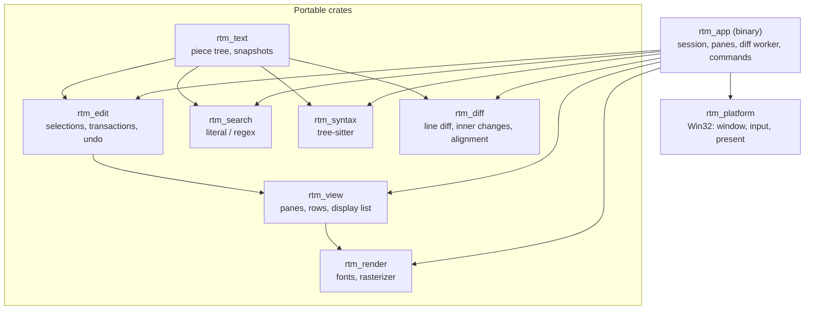

# Architecture 001

Status: Draft. A design sketch with the owner's decisions of 2026_11_05 and
the answers to GPT-6 Astra's review (A1-A8); awaiting re-review.

## Milestones

| Milestone       | Status  | Features                                                                                                                                                                                                                                         | Commands and keys                                                                                    | Crates                                | Gate                                                                                  |
| --------------- | ------- | ------------------------------------------------------------------------------------------------------------------------------------------------------------------------------------------------------------------------------------------------ | ---------------------------------------------------------------------------------------------------- | ------------------------------------- | ------------------------------------------------------------------------------------- |
| M0 Fork         | Done    | Copy of the Editor workspace at `b23bfa9`; renamed crates, binary, metadata, window class, clipboard format and save names; adapted workflows and scripts                                                                                        | The Editor's                                                                                         | All                                   | The renamed single-pane application builds and passes its tests and startup benchmark |
| M1 Two panes    | Done    | `Session` and two `Pane`s, identity alignment; up to two paths; empty panes, drag and drop per pane; focus; headers and status per pane; prompts, session save queue, Save All and closing over two files; modes and the `diff` lock; Swap Sides | `Ctrl+1` / `Ctrl+2`, `Ctrl+Tab`, `Alt+\`, `Ctrl+K S`, Toggle Diff Mode, `--read-only`, `--diff-mode` | `rtm_app`, `rtm_view`, `rtm_platform` | None                                                                                  |
| M2 Diff engine  | Done    | Line diff (prefix and suffix, interned ids, histogram, Myers fallback), slider heuristic, verification, `Identical` check, inner changes, alignment; property tests                                                                              | None (a library)                                                                                     | `rtm_diff`                            | None; benches decide between the own diff and `imara-diff`                            |
| M3 Aligned view | Done    | Diff thread and tickets; startup deadline; rows in the view; diff colors, inner fills, hatched fillers; overview ruler; shared scroll                                                                                                            | None                                                                                                 | `rtm_app`, `rtm_view`, `rtm_render`   | First frame and frame budgets with two files                                          |
| M4 Merge        | Done    | Provisional mapping and re-diff of provisional regions; current change and gap positions; Copy to Right / Left, also to the next change; divider arrows; encoding check; next / previous change                                                  | `Alt+Right` / `Alt+Left`, `Ctrl+Alt+Right` / `Ctrl+Alt+Left`, `Alt+F5` / `Shift+Alt+F5`              | `rtm_app`, `rtm_diff`                 | Mapping and undo benchmarks within the frame budget, or the prepared relative ranges  |
| M5 Options      | Done    | Ignore trim whitespace; the `diff:` settings                                                                                                                                                                                                     | Toggle Ignore Trim Whitespace                                                                        | `rtm_app`, `rtm_diff`                 | None                                                                                  |
| M6 Release      | Done    | Documentation (README, book), the Merger's performance benchmark, the portable ZIP (`cargo xtask package`) attached to the first GitHub release                                                                                                  | None                                                                                                 | `xtask`, `docs`                       | None                                                                                  |

## Task

Define the architecture of `RoyiTextMerger`: a keyboard-driven, frameless
Diff & Merge tool for a pair of text (code) files on Windows, written in Rust.

It is a new application built on the design and code of
[RoyiTextEditor](https://github.com/RoyiAvital/RoyiTextEditor) (below: the
Editor). Each pane keeps the Editor's editing, search, syntax highlighting and
safe saving. The Merger adds the comparison, the aligned two-pane view and
merging.

Priorities, in order:

1. **Speed.** First frame of two small files in < 100 ms from process creation
   (goal ≤ 50 ms warm). Keystroke to screen within the next vsync, also while
   the diff catches up. Scrolling at display refresh rate.
2. **Correctness.** Byte-exact preservation of everything the user did not
   edit. Lines shown as unchanged are equal on both sides (up to the ignored
   whitespace and line breaks, see [Diff](#diff-rtm_diff)).
3. **Aesthetic, keyboard-first UX.** No menus, frameless, crisp monospaced
   text, changes visible at a glance.

Baseline: the Editor at commit `b23bfa9` (v0.6.2) and its
[Architecture](https://github.com/RoyiAvital/RoyiTextEditor/blob/b23bfa9950c97f9454922d3a4de9c0b7dec4ff2d/Done/Architecture001.md).
**Everything this document does not change follows that Architecture.** This
document records the differences.

## Scope

### Included

- One session per process; one pair of files per session: the **left** pane
  (the original) and the **right** pane (the modified file), side by side.
- Launch: `RoyiTextMerger <Left> <Right>`, typically from a file manager.
- **Compare:** a line diff, with the changed characters marked inside changed
  lines; both panes aligned row by row (filler rows on the shorter side); one
  shared vertical and horizontal scroll; an overview ruler of all changes.
- **Merge:** copy a change to the other side (both ways), optionally moving on
  to the next change; go to the next / previous change; swap the sides.
- **Per-pane parity with the Editor:** editing, multiple cursors, search and
  replace, syntax highlighting, spelling, Go to Line / Symbol, code commands,
  progressive loading, safe saving, external change detection.
- **Modes:** merge (default, both panes editable), read-only (`--read-only`:
  the left pane read-only, as VS Code) and diff mode (`--diff-mode`: both
  panes read-only, reviewing the differences); Toggle Read-Only per pane
  ([Modes and Merge Direction](#modes-and-merge-direction)).
- **Files** from the command line or dropped on a pane; a pane without a file
  shows an empty state.
- Ignoring leading and trailing whitespace in the comparison (on by default,
  as VS Code).
- The Editor's session features: Command Palette, favorites, zoom, full
  screen, About, Keyboard Shortcuts, configuration file.

### Excluded

- 3-way merge (a base and two versions), Git conflict resolution
  (`git mergetool`), folder comparison, more than two files.
- Inline (unified) diff view; resizing the split (v1 splits the width in half).
- Collapsing unchanged regions (VS Code `hideUnchangedRegions`): later,
  together with folding in the Editor.
- Moved-code detection, syntax-aware (tree) diff, binary or hex comparison,
  patch export.
- The Editor's road map items (word wrap, folding, minimap, light theme, ...).

### Compatibility Constraints

- The Editor's constraints hold per file: never normalize line endings, BOM or
  invalid UTF-8 silently; no save path deletes the only copy; the
  configuration is never written; state lives under `UserSettings/`; no
  Registry writes; Win32 code only in `rtm_platform`.
- One deliberate conversion: a copied change takes the target file's line
  ending (VS Code converts inserted text to the model's line ending).
- Command IDs follow VS Code's compare editor where one exists, otherwise
  `royi.*` (as the Editor).
- No build or runtime dependency on the Editor repository
  ([Code Base](#code-base)).

## Design

### Principles

The Editor's principles 1-7 apply: work proportional to what is visible or
changed, a UI that never waits, immutable snapshots with stale-result
rejection, startup doing only what the first frame needs, few dependencies,
pure core crates, speed over memory. Changed and added:

8. **Single session.** A session handles one pair of files. It never launches,
   closes or contacts other sessions.
9. **The diff never blocks typing.** The exact diff runs on a worker. Until it
   arrives, the UI maps the last diff through the edit for display only; a
   mapped diff never authorizes a merge.
10. **Symmetric panes.** Both panes run the same code (`Pane`). What a pane
    allows follows from its locks: a copy into a read-only pane is refused,
    so the modes and the merge direction need no code of their own.

### Code Base

The Merger starts as a copy of the Editor workspace at `b23bfa9`, renamed.
The copied code lives and is maintained in this repository. The Merger must
not depend on the Editor repository or fetch its source or crates at build or
runtime: no Git submodules, path or Git dependencies, or published Editor
packages. Normal third-party dependencies remain allowed. From time to time,
the code is checked for parity with the Editor and relevant fixes are ported
by hand.

| Editor         | Merger         | Change                                                                |
| -------------- | -------------- | --------------------------------------------------------------------- |
| `rte_text`     | `rtm_text`     | None                                                                  |
| `rte_edit`     | `rtm_edit`     | None                                                                  |
| `rte_search`   | `rtm_search`   | None                                                                  |
| `rte_syntax`   | `rtm_syntax`   | None                                                                  |
| `rte_spell`    | `rtm_spell`    | None                                                                  |
| (new)          | `rtm_diff`     | Line diff, inner changes, alignment (pure, no I/O)                    |
| `rte_view`     | `rtm_view`     | Pane regions, row model, diff decorations, overview ruler, divider    |
| `rte_render`   | `rtm_render`   | Hatched fill primitive for filler rows                                |
| `rte_assets`   | `rtm_assets`   | None                                                                  |
| `rte_platform` | `rtm_platform` | Window class name; a drop reports its point and its first two paths   |
| `rte_app`      | `rtm_app`      | `Session` with two `Pane`s, diff coordination, commands, command line |
| `xtask`        | `xtask`        | Benchmarks with two files and the diff                                |

`tools/`, `Meta/` (new icons) and `.github/` (workflows, scripts) are copied
and renamed too. The display name, file name, version and links come from
`Meta/AppMeta.json` (window title, configuration file name, package), as in
the Editor. Hard-coded Editor names change: the clipboard format
(`RoyiTextMerger.Selections`), the window class, the temporary save names
(`P.~rtm-<pid>.tmp`), the About manifest and the release tag message.

### Overview



`rtm_view` does not depend on `rtm_diff`: the app hands each pane its visible
rows as plain data.

### Window Layout

```text
┌─────────────────────────────────┬─────────────────────────────────────────┐
│ left.rs                         │ right.rs ●             Royi Text Merger │  title strip
├────┬────────────────────────────┼───┬────┬────────────────────────────┬───┤
│ 11 │ fn area(w: u32) -> u32 {   │   │ 11 │ fn area(w: u32) -> u32 {   │   │  unchanged
│ 12 │     w * w                  │→ ←│ 12 │     w * h                  │ ▌ │  changed (inner change w → h); → / ← copy it
│    │╱╱╱╱╱╱╱╱╱╱╱╱╱╱╱╱╱╱╱╱╱╱╱╱╱╱╱╱│   │ 13 │     // squared             │ ▌ │  inserted; a filler row on the left
│ 13 │ }                          │   │ 14 │ }                          │ █ │  overview ruler: change marks, slider
├────┴────────────────────────────┴───┴────┴────────────────────────────┴───┤
│ 2 changes               Right  ·  Ln 13, Col 16  ·  UTF-8  ·  LF  ·  Rust │  status line
└───────────────────────────────────────────────────────────────────────────┘
```

- **Title strip:** one header per pane, aligned with it: the file name, the
  unsaved marker `●` and `RO`. The focused pane's header is bright, the other
  dim. The application name stays right-aligned when it fits.
- **Panes:** each has its gutter (line numbers, `-` / `+` change indicators)
  and its text area. The width is split in half (VS Code
  `splitViewDefaultRatio: 0.5`). The search box opens at the top right of the
  focused pane.
- **Divider** (three cells) between the panes: `→` and `←` on the first row
  of each change, each while its target pane is editable; a click copies the
  change that way and leaves the focus.
- **Overview ruler** (right edge, about 14 px at 96 DPI, replacing the
  Editor's scroll strip): the changes of the whole comparison, left changes in
  its left half and right changes in its right half, over the slider.
  Press, drag and click work as the Editor's slider and leave the focus. It
  belongs to the right pane's layout, or to the left one's while only that
  pane has a file.
- **Status line:** notices and prompts on the left, otherwise the diff state
  (`2 changes`, `Comparing…`, `Identical`, see [Diff](#diff-rtm_diff)); on the
  right the focused pane's side, position, encoding, line ending, language and
  lock, and `Whitespace compared` while trim whitespace counts.
- **Window title:** `a.rs ↔ b.rs - Royi Text Merger`, marked `●` while a pane
  has unsaved changes; with one file only its name, without files the
  application name.

### Session and Panes (`rtm_app`)

The Editor's `Editor` struct mixes the state of its file with the state of the
window. The Merger splits it:

- **`Pane`:** everything per file, the fields the Editor's `reset_document`
  resets: `Document`, path, file info, baseline, load and pending open,
  language and syntax thread, search box and search thread, spelling marks,
  watcher and disk state, save slot, caches, cursor history. The Editor's
  `editor/*.rs` modules (lifecycle, find, cursors, code, spell, goto) become
  `Pane` methods.
- **`Session`** (the `App`): renderer and zoom, DPI, theme, full screen,
  popups (palette, panels), the favorites store, chords, the prompt and
  notice, `focus: Side`, `panes: [Pane; 2]`, the diff state and the shared
  scroll.
- **Focus.** Keys go to the focused pane; a click focuses its pane. The
  unfocused pane draws its selections dimmed and no caret (as VS Code).
- **Wake-ups.** Every worker wakes the one window; `Event::Wake` drains each
  pane (loads, saves, watcher, search, syntax), spelling and the diff thread.
- **Repaint fingerprint.** `Visible` becomes a session part, one part per pane
  and the diff generation.
- **Prompts.** One at a time on the status line, each naming its file:
  `right.rs changed on disk.   R: Reload   S: Save Current`. A prompt of the
  other pane waits until the first is answered. Closing with unsaved changes
  asks once for all dirty files
  (`Save changes to a.rs and b.rs?   Enter: Save   D: Discard   Esc: Cancel`)
  and saves them all.

### Modes and Merge Direction

The left pane is the **original** and the right pane the **modified** file (VS
Code). By default both are editable and changes copy both ways (WinMerge,
Meld, Beyond Compare).

| Mode      | Command line  | Left pane | Right pane | Copying changes                 |
| --------- | ------------- | --------- | ---------- | ------------------------------- |
| Merge     | (default)     | Editable  | Editable   | Both ways                       |
| Read-only | `--read-only` | Read-only | Editable   | Left to right (as VS Code)      |
| Diff      | `--diff-mode` | Read-only | Read-only  | None: reviewing the differences |

- **Locks.** The modes are the Editor's edit-permission locks, so they refuse
  edits, not saving. `--read-only` sets the left pane's `user` lock; Toggle
  Read-Only (the Editor's command) toggles the focused pane's.
- **Diff mode** is a new lock, `diff`, on both panes, owned by the mode:
  `--diff-mode` and `Diff: Toggle Diff Mode` set and clear it without touching
  the panes' `user` locks, so leaving diff mode restores them. While it is on,
  the status line shows `Diff mode` and the palette dims the commands that
  edit; navigation, search and copying to the clipboard work.
- **Copy direction** follows from the locks: Copy to Right and Copy to Left are
  one function with the sides exchanged, refused while the target pane is
  locked. The divider shows only the arrows that can copy.
- **Swap Sides** (VS Code `workbench.action.compareEditor.swapSides`)
  exchanges the panes: files, documents, undo histories, search boxes and
  syntax threads. The diff is mirrored, not computed again. `--read-only`
  describes the left side: after a swap the new left pane is read-only and the
  new right one editable; a toggled read-only state returns to the command
  line's (as the Editor resets it when another file opens). Unsaved changes
  survive the swap and can still be saved.
- A file dropped on a pane gets that side's command-line lock as well.

### Diff (`rtm_diff`)

Pure functions over two snapshots; no threads and no I/O (the app runs them on
the diff thread).

- **Lines** are compared without their line breaks: an LF file and a CRLF file
  with the same lines are equal. With `diff.ignoreTrimWhitespace` (default
  `true`, as VS Code) leading and trailing ASCII whitespace is ignored as
  well.
- **Line diff:**
  1. Common prefix and suffix lines, compared bytewise over chunks (no
     hashing). Similar files reduce to small middles at memory speed.
  2. Each remaining line gets a 64-bit XXH3 hash, interned into dense `u32`
     ids (one map for both sides).
  3. Histogram diff (Git's algorithm) on the id sequences, after marking the
     lines whose id the other side lacks as changed (they never pair; GNU
     diff and `imara-diff` prune them too). Regions without a rare common
     line fall back to Myers (O(ND)); past √N edits (at least 256) Myers
     splits at its furthest path, as Git does, so repetitive texts with many
     changes stay near O(N·√N) instead of quadratic. Both check the cancel
     token and the deadline.
  4. **Slider heuristic** (Git's indent heuristic): an ambiguous insertion or
     deletion moves to blank lines or indentation boundaries, so a change
     starts where a reader expects it. It compares lines bytewise, moves a
     hunk at most 100 lines (Git's limit) and never into the empty line after
     a final line break (not a line for Git).
  5. **Verification** of the final runs, after sliding: the lines of the
     unchanged runs the ids paired (the middle and the 100 lines the slider
     reaches around it) are compared bytewise, by the same rules (without
     breaks; trimmed while whitespace is ignored); a hash collision becomes a
     change. "Unchanged" is therefore exact.
- **Result:** `Diff { hunks: Vec<Hunk>, complete: bool }` with
  `Hunk { left: Range<u64>, right: Range<u64> }` in lines; an empty range is a
  pure insertion or deletion. The result is proportional to the changes;
  comparing takes about 4 bytes per line per side plus a map of the distinct
  lines, freed afterwards. `diff_region` diffs only a region of lines (the
  lines around it count as unchanged): the re-diff of provisional hunks.
- **Identical or not.** Without hunks, the worker also compares the texts
  byte for byte (`Diff::status`: `Identical`, `Equivalent` or the number of
  changes). The status line says `Identical` only when they are equal and
  the encodings match; otherwise
  `No changes (whitespace, line breaks or encoding differ)`, so ignored
  differences never pass as identical files.
- **Inner changes:** for hunks with lines on both sides, a diff of tokens
  (words, runs of spaces and tabs, single other characters, line breaks); a
  word replaced by a word at least two thirds equal is refined to its changed
  code points, otherwise it changes whole (VS Code's rule for extending a
  change to the whole word). An invalid UTF-8 byte counts as one unit, as the
  view draws it. Hunks above 64 KiB per side, or past a work limit, get
  whole-line highlighting only. Computed nearest to the view first and
  published progressively.
- **Limits:** files above `diff.maxFileMiB` (default 50, VS Code
  `diffEditor.maxFileSize`) are shown but not compared; the status line says
  why. A text growing past the limit drops the shown diff (identity rows).
  After `diff.maxComputationMs` (default 5000, VS Code
  `diffEditor.maxComputationTime`) the unresolved regions become whole hunks,
  `complete` is false and the status line adds
  `diff simplified after 5 s: changes are coarse` to the change count.
  Simplified hunks are still exact descriptions of where the texts differ,
  only larger.
- **Alignment** (`rtm_diff::Alignment`): see
  [Rows and Scrolling](#rows-and-scrolling).

### Diff Thread and Tickets

- **One diff thread** per session, started at startup (comparing is the main
  feature, so it is not lazy).
- **Requests:** line work (a full diff or a region re-diff) and inner changes
  near the view. A new line request replaces a queued one and cancels a
  running one through its `CancelToken`. Inner work never cancels line work;
  it runs only while no line work is pending, in slices of 8 ms. A line reply
  carries the inner changes of the hunks a page around the view that fit its
  first slice; the UI asks for the others as the view reaches them, nearest
  first. Inner requests for the same texts join, the newest view's hunks
  first, so no asked hunk is lost.
- **Tickets.** A request carries both snapshots and the diff generation. The
  generation grows with every change that is not an edit: an option, a swap, a
  load or reload of either pane. A reply is accepted only when its generation
  is current and both snapshots are the panes' current ones (`same_tree`);
  otherwise it is dropped. A swap mirrors the shown diff, which is a diff of
  the swapped texts, and keeps it; its inner changes still in flight are
  asked again under the new generation. Only a current diff takes the new
  generation: one of an older generation (another option, its reply not in
  yet) is mirrored for display and stays stale until the diff under the
  current option replaces it.
- **Edits.** After an edit the UI maps the hunks through the edit's `ChangeSet`
  for display (`rtm_diff::map_edit`, fed by a `diff_journal` of each document,
  as syntax and spelling have theirs): the lines each change touched and the
  hunks touching them become a provisional hunk, later hunks shift, so the
  panes stay aligned in the same frame. Inner changes after the edit shift
  with its bytes. Every line request re-diffs all provisional hunks at once,
  each region with up to 100 unchanged lines around it (the slider's reach,
  never closer than one line to a neighbor and at most halfway to a
  neighbor re-diffed too), so a cancelled request loses nothing; when the
  regions cover half of the longer text, a full diff runs instead. A
  **revision** grows whenever the hunks change: region results and inner
  changes splice only into the revision they were asked for. An accepted
  reply is for the current snapshots and revision, so it resolves every
  provisional hunk. While a hunk is provisional the status line says
  `Comparing…`; a small file is re-diffed within a millisecond. An edit
  whose change set is empty (new trees of the same bytes, as an undo of a
  replacement by the same text) keeps the texts' equality.
- **Undo and redo** are not journaled in the Editor; their change comes from
  `Snapshot::diff`, as for syntax. It walks both trees' subtrees in step and
  skips those they share by pointer (opening a node split or merged by the
  edit), so its time follows the tree's depth, not the text's size.
- **Mapping cost.** Hunks keep absolute line ranges, so an edit shifts the
  hunks after it: one memory pass, then the alignment is rebuilt. Measured in
  M4 within the frame budget (an early edit before 100,000 hunks; undo at
  50 MiB and at the setting's maximum, see
  [Performance Budgets](#performance-budgets)); the prepared relative ranges
  were not needed.
- **Merge authority.** A copy needs a fresh diff: the current snapshots and
  generation, and no provisional hunk. Completeness does not matter: a
  simplified diff copies its coarse hunks whole, as the status line says.
  Pressed while line work runs, the copy waits for that reply (a pending
  operation, as the Editor's search operations), which arrives within
  `diff.maxComputationMs`, and says so. It runs only in the state it was
  pressed in: an edit, another focus or selection, reaching another change
  or clicking a row cancels it with a notice, so it never acts on a change
  the user has left. Without a diff (fewer than two files, above the size
  limit) a copy is refused with a notice.
- **Startup.** Once both command-line files are read (with the window and the
  glyphs), the UI sends the first line request and waits for its reply up to
  10 ms before the first frame; with fewer than two files, or a file still
  loading, there is nothing to wait for. Past the deadline, the first frame
  shows both texts unaligned with `Comparing…`, and the aligned frame follows.
  Measured with two small C files: the diff arrives 0.1 ms after the second
  load (a loader hook would save nothing).
- **Large files** load progressively per pane (read-only until loaded, as in
  the Editor). The comparison starts when both are loaded.

### Rows and Scrolling

Both panes share one **row space**, so they scroll as one (VS Code
synchronizes both scroll directions):

- An unchanged run maps line to line. A hunk takes
  `max(left lines, right lines)` rows; the shorter side gets **filler rows**
  after its lines.
- `Alignment` keeps the runs and hunks with their first rows (prefix sums).
  Row to (left line or filler, right line or filler, kind) and line to row take
  O(log hunks). After an edit only the rows after the last hunk change
  (`set_lines`, O(1)); a new diff rebuilds it.
- **Shared scroll:** `{ top_row, first_col }`, one for the session (the wheel
  scrolls both panes wherever the pointer is). Revealing the caret converts its
  line to a row. Each pane moves its caret by its own lines (`Up`, `PgDn`,
  ...); the view follows. Work on a pane's visible text (syntax, search
  highlights, spelling) takes the pane's lines shown between the first and
  the last row, a contiguous range since lines grow with rows on each side.
- **Gap position.** A change with no lines on one side has, on that side, the
  start of the line after the gap (the end of the text past the last line;
  0 in an empty document). Navigation and filler clicks place the caret
  there.
- **Clicks** on a change's rows, its filler rows or its divider arrows make it
  the current change ([Merging](#merging)); a click on a filler row puts that
  pane's caret at the gap position.
- **Before the first diff** (and above the size limit) the alignment is the
  identity: row = line in both panes, filler rows after the shorter file.

This is the row iterator the Editor's Architecture planned for word wrap and
folding; the Merger needs it first. Collapsed unchanged regions (VS Code
`hideUnchangedRegions`) will be hidden rows of the same model, built together
with folding in the Editor.

### View (`rtm_view`)

- **Layout.** `Layout::new` with `Options.pane` gives a pane's half of the
  window beside the divider; the title strip and the status line are shared.
- **Rows instead of lines.** A pane frame gets its visible rows:
  `Row { line: Option<u64>, kind, inner: &[Range<u64>] }` with `kind` one of
  `Same`, `Removed`, `Inserted`, `Filler` (a changed line is `Removed` on the
  left and `Inserted` on the right). The row loop walks them instead of
  `top_line + row`. Clicks map their row in the app: a line hits as in the
  Editor (`hit_line`), a filler row gives the gap position.
- **Builders.** `build_pane` draws a pane (text, selections, search matches,
  syntax colors, spelling marks, diff decorations, the overview ruler in its
  scroll strip); `build_split_chrome` draws the title headers, the divider
  and the status line. Each pane clips to its region, as the Editor's glyphs
  clip to theirs.
- **Decorations:** line backgrounds for removed (left) and inserted (right)
  lines on the gutter and the text, stronger fills for inner changes, `-` /
  `+` indicators in a gutter column of their own (a space on each side),
  filler rows hatched with diagonal lines (VS Code). The hatch is one new
  display-list primitive drawn by `rtm_render`, like the spelling waves, with
  its spacing from the row height, so a partial last row clipped to the body
  keeps the lines of a whole one. Decorations never leave the pane's body.
- **Theme:** diff colors from VS Code's dark theme, blended over the
  background (pixels stay opaque).
- **Overview marks** are computed once per diff, row count and track height
  (per pixel row, merged into runs, at least 2 px per change), not per frame.

### Merging

- **Current change** (WinMerge's current difference): the change holding the
  focused caret's line; otherwise the one last reached by Next / Previous
  Change, a click on its rows or filler rows, or its divider arrows (a click
  on a row without a change clears it; keys keep it). It is a hunk index kept
  through edits (merged into a provisional hunk, it is that hunk) and
  re-diffs (its region's first hunk, or after a full diff the first change
  meeting its lines); it clears when its rows no longer hold a change.
- **Copy to Right / Copy to Left** (`Alt+Right` / `Alt+Left`): replaces the
  target pane's lines of the changes the focused pane's selections touch (a
  caret by its line; a selection by its lines and the gaps at and between
  them), otherwise of the current change, with the source pane's lines; an
  empty source side deletes the target's lines. At the end of a text the
  copy takes the line break before each line, so a missing final break stays
  missing. Target ranges of separate changes can touch (several changes into
  an empty file, separated by an empty line): they join, in order, into one
  edit. One transaction on the target document: one undo step in the target
  pane. Refused with a notice while the target pane is locked; the palette
  dims a copy by its target pane's locks, not the focused pane's.
- **Copy and go to the next change** (`Ctrl+Alt+Right` / `Ctrl+Alt+Left`,
  WinMerge): the same, then the change after the last copied one (the caret
  is placed before the edit, which maps it). VS Code has no such command.
- **Copied text** is copied with the target's line ending: one memory pass,
  bounded by `diff.maxFileMiB` and counted in the undo budget as typed text.
- **Encodings.** A UTF-16 file cannot store invalid UTF-8 bytes. Before a copy
  into a UTF-16 pane the copied bytes are checked; invalid bytes refuse the
  copy with a notice and nothing changes.
- **Next / Previous Change** (`workbench.action.compareEditor.nextChange` /
  `previousChange`): the next change below (above) the focused caret's row in
  the row space, wrapping at the ends. It becomes current; the caret goes to
  its first line on the focused side, or to the gap position when that side is
  empty; the view reveals it.

### Files

Per pane, as in the Editor: progressive loading, encodings, the save sequence
with `ReplaceFileW`, baselines, the watcher and the Reload / Save Current
prompt.

- **Empty panes.** A pane without a file shows `Drop a file here`, as the
  Editor's empty state. Zero or one path on the command line leaves the
  missing panes empty. The comparison runs once both panes hold a file.
- **Drag and drop.** A file dropped on a pane opens in it; dropped elsewhere
  (title strip, divider, status line) it opens in the focused pane. Two files
  dropped together open as the left and the right file, only when both panes
  allow it; further files are ignored with a notice. A pane with unsaved
  changes or a running save is not replaced (a notice says why); folders are
  refused. The platform reports the drop point (`DragQueryPoint`) and the
  first two paths.
- **Close and quit.** `File: Close` (`Ctrl+W`, `Ctrl+F4`) closes both files
  (asking first about unsaved changes) and leaves two empty panes; `Alt+F4`
  quits.
- **Saving.** `File: Save` (`Ctrl+S`) saves the focused pane; `File: Save
  All` (`Ctrl+K S`) saves every pane with unsaved changes, the focused one
  first. Saves run one at a time per session: the Editor's save slot becomes
  a session queue, so two saves never write side by side.
- **One file in both panes** is allowed: two documents of one file. When both
  are saved, the second save finds the first one's version on disk and its
  pane asks `R: Reload   S: Save Current`: the user picks the version that
  stays.
- **Closing** runs the Editor's sequence over both panes: wait for running
  saves (input waits, `Saving…`); answer open prompts (conflicts, failures);
  while a pane is dirty, ask once for all dirty files; quit, or empty both
  panes, only when none is dirty or the user discards. `R` in a prompt
  cancels the close, as in the Editor.
- Edits and saves closer together than a person acts follow the Editor's rules
  (an edit during a save keeps its pane dirty) and are not coordinated further
  (DEVELOPMENT.md, Single User, Single Computer).
- Different encodings or line endings are not changes; the status line shows
  each pane's.

### Startup

```text
t0 main ─ parse CLI ─ read RoyiTextMerger.yaml (tiny, sync) ─ spawn threads
 ├─ loader L: first block → encoding → tree → language → syntax prep → rest
 ├─ loader R: the same
 ├─ diff:     waits for both texts → line diff → inner changes near the top
 ├─ glyphs:   embedded face → cell metrics → ASCII
 └─ UI:       register class → CreateWindowExW (hidden) → join both first
              snapshots + glyphs → wait diff ≤ deadline → layout → render
              → ShowWindow + present → message loop
```

Syntax threads start per pane as in the Editor (early start for the
command-line files).

### Command Line and Configuration

```text
RoyiTextMerger.exe [--read-only | --diff-mode] [--syntax <id>] [--spelling <engine>] [<left> [<right>]]
```

- `--read-only`: the left pane is read-only; `--diff-mode`: both panes are
  read-only ([Modes](#modes-and-merge-direction)); given together, diff mode
  applies. They apply to every file opened in the session, as the Editor's
  `--read-only`.
- `--syntax` applies to both command-line files; `--spelling` as in the Editor.

`RoyiTextMerger.yaml` keeps the Editor's sections and adds:

```yaml
diff:
  ignoreTrimWhitespace: true  # leading and trailing whitespace is not a change
  maxFileMiB: 50              # larger files are not compared, 1 to 1024
  maxComputationMs: 5000      # then the diff is simplified, 100 to 60000
```

As the Editor's settings, they are read once at startup; an invalid value
keeps its default and is reported on the status line. `Diff: Toggle Ignore
Trim Whitespace` flips the option for the session (the file is never
written): a new generation, so the drawn diff stays, `Comparing…`, until the
diff under the new option replaces it whole. While whitespace counts the
status line shows `Whitespace compared`, as the Editor shows `Syntax off`.

### Command Coverage

Every Editor command keeps its keys and acts on the focused pane, except the
session commands (palette, panels, zoom, full screen, quit). Keys follow VS
Code; where VS Code has none, the key common in other tools is used when it is
free, otherwise an own key. Added, in a new `Diff:` family:

| Keys                               | Command                                          | ID                                                               | Source                                                   |
| ---------------------------------- | ------------------------------------------------ | ---------------------------------------------------------------- | -------------------------------------------------------- |
| `Alt+F5` / `Shift+Alt+F5`          | Diff: Next / Previous Change                     | `workbench.action.compareEditor.nextChange` / `previousChange`   | VS Code                                                  |
| `Alt+Right` / `Alt+Left`           | Diff: Copy Change to Right / Left                | `diffEditor.revert` / `royi.copyChangeToLeft`                    | WinMerge and Meld keys; VS Code has Revert without a key |
| `Ctrl+Alt+Right` / `Ctrl+Alt+Left` | Diff: Copy Change to Right / Left and Go to Next | `royi.copyChangeToRightAndNext` / `royi.copyChangeToLeftAndNext` | WinMerge                                                 |
| `Alt+\`                            | Diff: Swap Sides                                 | `workbench.action.compareEditor.swapSides`                       | VS Code command, Meld key                                |
| `Ctrl+Tab`                         | Diff: Switch Side                                | `diffEditor.switchSide`                                          | VS Code command, own key                                 |
| `Ctrl+1` / `Ctrl+2`                | Diff: Focus Left / Right Pane                    | `royi.focusLeftPane` / `royi.focusRightPane`                     | Own (VS Code focuses editor groups with them)            |
| Palette                            | Diff: Toggle Diff Mode                           | `royi.toggleDiffMode`                                            | Own                                                      |
| Palette                            | Diff: Toggle Ignore Trim Whitespace              | `toggle.diff.ignoreTrimWhitespace`                               | VS Code                                                  |
| `Ctrl+K S`                         | File: Save All                                   | `workbench.action.files.saveAll`                                 | VS Code                                                  |

These keys are free in the Editor's registry (an unbound `Alt` key falls
through to the system there). Some Intel graphics drivers bind
`Ctrl+Alt+arrows` to screen rotation; current drivers ship it off.

Keys of other tools (WinMerge's manual, Meld's source, Beyond Compare's
shortcut lists):

| Action                 | VS Code                   | WinMerge                 | Meld                     | Beyond Compare      |
| ---------------------- | ------------------------- | ------------------------ | ------------------------ | ------------------- |
| Copy a change          | No key                    | `Alt+Right` / `Alt+Left` | `Alt+Right` / `Alt+Left` | `Ctrl+R` / `Ctrl+L` |
| Next / previous change | `Alt+F5` / `Shift+Alt+F5` | `Alt+Down` / `Alt+Up`    | `Alt+Down` / `Alt+Up`    | `Ctrl+N` / `Ctrl+P` |
| Switch pane            | No key                    | `F6` / `Shift+F6`        | `Alt+PgDn` / `Alt+PgUp`  | Not checked         |
| Swap sides             | No key                    | Not checked              | `Alt+\`                  | `Ctrl+U`            |

`Alt+Up` / `Alt+Down` (Move Line), `Alt+PgUp` / `Alt+PgDn` (Scroll Page),
`Ctrl+L` (Select Line), `Ctrl+P` (recent commands) and `Ctrl+U` (Cursor Undo)
are VS Code keys the Editor already uses.

### Performance Budgets

Targets to verify on the Editor's reference machine, not measurements.

| Stage                                         | Budget                                             |
| --------------------------------------------- | -------------------------------------------------- |
| First frame, two small files, warm start      | < 100 ms required, ≤ 50 ms goal                    |
| Diff of two 1 MiB code files with few changes | ≤ 10 ms (the startup deadline)                     |
| Re-diff after a keystroke, files ≤ 1 MiB      | ≤ 1 ms on the worker                               |
| Keystroke to presented frame                  | Next vsync, render ≤ 2 ms                          |
| Frame of both panes, 1080p / 4K               | ≤ 1 ms / ≤ 3 ms (Editor, one pane: 0.36 / 1.16 ms) |
| Idle CPU, unfocused                           | 0 wakeups                                          |

The startup gate is the Editor's: first frame p95 of single-language files (C
as reference), here a pair of them.

M3 measurements (2026_11_08, a loaded development machine, not the reference
one): first frame of two C files (`cargo xtask bench-startup --pair`) median
47.5 ms, p95 51.6 ms; one file median 47.3 ms. Frame of both panes
(`cargo bench -p rtm_render -- two_panes`) median 0.87 / 2.82 ms at
1080p / 4K, in a run where one pane (`full_frame`) took 0.60 / 2.28 ms, twice
the Editor's recorded times; an earlier run gave 3.48 ms at 4K.

M4 measurements (2026_11_08, the same machine), the gate: the provisional
mapping of an early keystroke before 100,000 hunks with the new alignment
(`cargo bench -p rtm_diff -- mapping`) median 0.74 ms, 0.82 ms when it adds a
line. The change of an undo (`cargo bench -p rtm_text -- undo`) 1.3 µs at
50 MiB and 1.2 µs at 1 GiB, after `Snapshot::diff` learned to skip shared
subtrees (before: 0.32 ms and 8.3 ms). Frame of both panes with copy arrows
median 0.84 / 2.50 ms at 1080p / 4K.

### Decisions

| Topic         | Decision                                                                                              |
| ------------- | ----------------------------------------------------------------------------------------------------- |
| Code base     | Fork of the Editor at `b23bfa9`; crates renamed `rtm_*`; fixes ported by hand                         |
| Sides         | Left is the original, right the modified file (VS Code)                                               |
| Modes         | Merge (default, both editable), `--read-only` (left read-only), `--diff-mode` (both read-only)        |
| Direction     | Both ways; a copy into a locked pane is refused                                                       |
| Files         | Command line or drag and drop per pane; empty panes; `Ctrl+W` closes both files                       |
| Diff          | Histogram with a Myers fallback, verified unchanged runs, slider heuristic                            |
| Comparison    | Lines without breaks; trim whitespace ignored by default (VS Code)                                    |
| Inner changes | Words, refined to characters when two thirds equal; bounded per hunk                                  |
| Alignment     | One row space with filler rows; one scroll for both panes                                             |
| Collapsing    | Later, together with folding in the Editor                                                            |
| Updates       | Provisional mapping on the UI; every line request resolves all provisional hunks                      |
| Merging       | Needs a fresh diff (simplified allowed); a current change; copies are owned bytes                     |
| Saving        | One save at a time per session; one file in both panes resolved by the conflict prompt                |
| Limits        | Settings `diff.maxFileMiB` (50) and `diff.maxComputationMs` (5000), VS Code defaults                  |
| Keys          | VS Code where defined; otherwise WinMerge and Meld keys when free; own keys last                      |
| Layout        | Equal halves, a header per pane, three-cell divider, overview ruler                                   |
| Threads       | One diff thread; loader, syntax, search and watcher per pane; one save at a time; one spelling thread |

## Alternatives

- **Code base.** Selected: a fork. Rejected: depending on the Editor's crates
  (Git or path dependency): the view and the app change structurally, and two
  products would release in lock step. Rejected: one repository with two
  binaries: the products stay separate.
- **Merge direction.** Selected: both ways, limited by the locks (WinMerge,
  Meld, Beyond Compare); `--read-only` gives VS Code's one-way model. Rejected:
  one-way only, with Swap Sides for the other way (VS Code). Neither choice
  changes the architecture ([Modes](#modes-and-merge-direction)).
- **Diff mode.** Selected: both panes read-only, to review the differences.
  Deferred: collapsing unchanged regions (Beyond Compare's "Diffs" view, VS
  Code `hideUnchangedRegions`), to be built with the Editor's folding on the
  same hidden-row model.
- **Alignment.** Selected: one row space for both panes. Rejected: two scroll
  states kept in sync around blank view zones (VS Code's implementation): two
  states to reconcile, and hit tests and page moves inside the zones.
- **Line diff algorithm.** Selected: histogram with a Myers fallback: readable
  hunks for code (repeated `}` and blank lines do not anchor), near-linear on
  typical inputs. Rejected: Myers alone (VS Code's base; less readable on
  code), patience (no fallback where no line is unique). `imara-diff`
  (histogram and Myers in Rust, used by Helix and gitoxide) was the benchmark
  baseline in M2, as Ropey was for the Editor's text engine. Kept: the own
  implementation. `imara-diff` has no cancellation or deadline, and the own
  diff is within the budgets: similar 1 MiB code files 1.9 ms (`imara-diff`
  1.8 ms), unrelated 1 MiB 4.4 ms (2.5 ms), similar 50 MiB 191 ms (549 ms),
  100,000 repeated lines 8.7 ms (2.7 s), a one-line re-diff 4.4 µs
  (`cargo bench -p rtm_diff`).
- **Line identity.** Selected: hashes interned to ids, then verified bytewise.
  Rejected: comparing bytes inside the algorithm (slower), trusting the hashes
  alone (a collision would hide a change).
- **Updates while typing.** Selected: a provisional mapping on the UI and a
  re-diff of all provisional regions on the worker. Rejected: a full diff per
  keystroke (proportional to the file size), a diff on the UI thread
  (Principle 2), tracking each edit's region separately (a cancelled request
  would leave regions behind, review A1).
- **Filler placement.** Selected: after the shorter side's lines of a hunk.
  Later: aligning the lines inside a hunk by their inner changes (VS Code).
- **Copied text.** Selected: copying the bytes, bounded by `diff.maxFileMiB`
  and counted in the undo budget. Rejected: sharing the source snapshot's
  leaves (`Piece::Foreign`): a small slice keeps a whole loaded block (up to
  16 MiB) alive after the source reloads, outside any budget (review A7).
- **Hunk ranges.** Selected: absolute line ranges; an early edit before
  100,000 hunks maps in 0.8 ms (M4). Rejected for now: relative offsets with
  prefix sums (review A6), kept in reserve should larger diffs miss the frame
  budget.
- **Undo change source.** Selected: `Snapshot::diff` skipping subtrees both
  trees share (time by depth: 1.2 µs at 1 GiB). Rejected: undo steps keeping
  their `ChangeSet` (review A6): coalesced steps would need composed change
  sets, and the walk is already within the budget.

## Runtime Effects

- **Startup:** the Editor's startup with two loaders and a diff thread; the
  diff of small files fits a short deadline before the first frame. No other
  work is added before the first frame.
- **Steady state:** zero CPU when idle (no timers). A keystroke costs the
  Editor's work in one pane, a provisional mapping (one pass over the hunks
  after the edit) and a re-diff of the provisional regions on the worker. A
  copy costs one pass over the copied text.
- **Memory:** two documents and up to two syntax trees (each bounded by
  `syntax.maxFileMiB`). Comparing takes about 4 bytes per line per side and a
  map of the distinct lines, freed afterwards; the result is proportional to
  the changes. Overview marks: one entry per pixel row.
- **I/O:** as in the Editor, per file. The diff does no I/O.
- **Threads:** the UI; at startup the glyph thread and one loader per pane;
  the diff thread; per pane a syntax thread (plus the whole-file parse above
  128 KiB), a watcher and a search thread after the first search; one save
  thread while saving (one save at a time); one spelling thread while
  spelling is on.
- **Cancellation:** diff requests carry a `CancelToken` checked per chunk of
  lines; replies are matched by generation and snapshots.
- **Disabled paths:** files above `diff.maxFileMiB` run no comparison; syntax
  and spelling off run nothing, as in the Editor.

## Tests

- **Diff (unit, property):** applying the hunks to the left lines yields the
  right lines; unchanged runs are byte-equal (up to the ignored whitespace and
  breaks); prefix and suffix; LF versus CRLF; empty files; no final newline; a
  forced hash collision is caught by the verification, also when it moves a
  hunk boundary while sliding; a deadline gives a valid, simplified diff; a
  region re-diff after random edits gives a valid diff; `Identical` only for
  byte-equal texts of the same encoding.
- **Alignment:** both panes have the same row count; row to line round trips;
  filler counts; gap positions at the start, the end and in an empty
  document.
- **Inner changes:** ranges on character boundaries; invalid bytes as single
  units; word extension; the per-hunk bound.
- **Tickets:** a reply for an older snapshot or generation is dropped; swap,
  reload and option changes bump the generation; a merge never runs on a
  provisional diff. With the worker paused: two distant edits and a
  multi-cursor edit, then a view request; the reply resolves every
  provisional hunk and a pending copy runs on it.
- **Merge authority:** after a forced timeout, a copy by key and by the
  divider replaces the simplified hunk whole; a copy pending during the timed
  out request runs on its reply; without a diff a copy is refused.
- **Changes without lines on a side:** insertions and deletions at the start,
  the end and against an empty document, from both panes: Next / Previous
  Change, filler clicks, the current change, and copies both ways.
- **Encodings:** invalid UTF-8 copied into a UTF-16 pane is refused; the text,
  its undo history and both files are unchanged.
- **Modes and locks:** a copy into a locked pane is refused and changes
  nothing; `--read-only` locks only the left pane; diff mode locks both and
  leaving it restores each pane's own lock; a swap returns the toggled locks
  to the command line's.
- **Headless integration (`Ctx::headless`):** two panes load; focus and keys;
  typing keeps the panes aligned in the same frame and the exact diff follows;
  a copy is one undo step in its target pane, both ways, also from an empty
  side and at the end of a file without a final line break; undo and redo
  re-align; copy and go to the next change; a swap keeps unsaved changes; one
  prompt at a time for two files.
- **Saving and closing:** Save All saves one pane after the other; one file in
  both panes ends with the second pane's Reload / Save Current prompt; a
  failed or conflicting save during a close returns to the prompts with both
  versions kept; a close while a save runs waits for it; the close question
  for two dirty files.
- **Files:** empty panes from zero or one path, and no comparison until both
  panes hold a file; a drop opens in the pane under the pointer, elsewhere in
  the focused pane; two dropped files open as left and right only when both
  panes allow it; a drop onto unsaved changes is refused; `Ctrl+W` closes both
  files.
- **View:** filler rows, diff backgrounds, inner fills and hatching per pane;
  clipping at the divider; divider arrows only toward editable panes; hit
  tests on filler rows; overview marks.
- **Performance:** `divan` benches of the diff (similar code files, unrelated
  files, many repeated lines, 50 MiB) against `imara-diff`; re-diff after a
  one-line edit; the provisional mapping of an early edit before 100,000
  hunks; undo and redo at 50 MiB and at the `diff.maxFileMiB` maximum; frame
  cost of two panes at 1080p and 4K; `xtask bench-startup` with two files.
- **Commands:** `cargo test -p <crate>` per changed crate; benches and the
  startup gate for performance work.

## Implementation Steps

Each milestone gets its own task document and builds on the previous ones.
The milestones and their status are listed in [Milestones](#milestones).

## Acceptance Criteria

- The owner reviews and approves this document.
- Every feature maps to an owning crate and a command.
- The performance budgets, their measurement and the gates (M0, M3, M4) are
  defined.
- Decisions are recorded before M0 starts.

## Reviewers

### 2026_11_05 - Claude Opus 5.5

- Role: Reviewer
- Activity: Design
- Agent: GitHub Copilot
- Model: Claude Opus 5.5
- Effort: High
- Context Window: 1M
- Outcome: Initial design sketch on the Editor at `b23bfa9`: a fork renamed
  `rtm_*`, a `Session` with two `Pane`s, a new `rtm_diff` crate (histogram
  line diff, verified unchanged runs, inner changes, alignment), one row space
  with filler rows, a diff thread with tickets and a provisional mapping, and
  VS Code's one-way merge with Swap Sides (the owner's suggestion). Six open
  decisions await the owner.

### 2026_11_05 - Claude Opus 5.5

- Role: Reviewer
- Activity: Review
- Agent: GitHub Copilot
- Model: Claude Opus 5.5
- Effort: High
- Context Window: 1M
- Outcome: Recorded the owner's decisions. Three modes: merge (default, both
  panes editable, copying both ways), `--read-only` (left pane read-only, as VS
  Code) and `--diff-mode` (both read-only, a new `diff` lock). Drag and drop
  and empty panes per pane; `rtm_*` crates; the size limit as a setting.
  Collapsing unchanged regions deferred to the Editor's folding. Keys: VS Code
  where defined, otherwise WinMerge and Meld (`Alt+Right` / `Alt+Left`,
  `Ctrl+Alt+Right` / `Ctrl+Alt+Left`, `Alt+\`) and own keys (`Ctrl+1` /
  `Ctrl+2`, `Ctrl+Tab`), checked free in the Editor's registry. No open
  decisions.

### 2026_11_05 - Claude Opus 5.5

- Role: Reviewer
- Activity: Review
- Agent: GitHub Copilot
- Model: Claude Opus 5.5
- Effort: High
- Context Window: 1M
- Outcome: Consistency pass before the external review. Added: verification
  by the comparison's own rules; `Identical` only for byte-equal texts, else a
  notice that ignored differences remain; undo and redo changes through
  `Snapshot::diff`; copies from an empty side; drops outside the panes, two
  files only into panes that allow it; no comparison with fewer than two
  files; both mode flags; the window title without two files. Ready for
  review.

### 2026_11_05 - GPT-6 Astra

- Role: Reviewer
- Activity: Review
- Agent: Copilot SDK in VS Code
- Model: GPT-6 Astra
- Effort: High
- Context Window: 1M
- Outcome: Changes requested before implementation. The review found eight
  gaps in diff authority, merge behavior, saving, or runtime bounds.

#### A1 [P1] Superseded region diffs can leave provisional hunks

If two distant edits arrive before the first region diff finishes, the second
request cancels it and re-diffs only the region around the second edit. The
first region can remain provisional even though the reply has the current
snapshots and generation. Those tickets alone cannot establish that the whole
result is exact. A near-view inner-diff request can also cancel needed line
work.

Track and resolve all outstanding dirty regions, or recompute the full diff,
before granting merge authority. Schedule inner work without losing required
line work. Test two distant edits and a view request while the worker is
paused, then verify both regions and any pending merge.

#### A2 [P1] Timeout and merge authority have no common contract

On timeout, unresolved regions become coarse hunks and `complete` is false,
but copying requires an exact diff and waits for the worker reply. The plan
does not say whether copying is refused, waits indefinitely, or replaces an
entire simplified region that may contain unchanged lines.

Define an explicit, visible policy for incomplete results, separate from
snapshot freshness. Test a forced timeout and both keyboard and divider
actions, including the outcome of an already-pending copy.

#### A3 [P1] Empty-side changes have no keyboard selection

An insertion or deletion has an empty range on one side. A caret cannot be
inside that range, and at EOF the range's first line can be past the last
line. Mapping filler clicks to the preceding line also has no preceding line
at the top of a file. Thus the specified caret-based navigation and copy do
not identify all changes from either pane.

Give changes a selectable identity independent of a text-line caret and
define filler hit testing and reveal positions. Test both directions at the
start and end of a file, including an empty document.

#### A4 [P1] Cross-encoding copies can make a target unsavable

The Editor preserves invalid UTF-8 bytes, while its UTF-16 writer rejects
invalid UTF-8. Copying such bytes from a UTF-8 source into an editable UTF-16
target can therefore produce an edit that cannot be saved. Character-level
diffing of invalid bytes is also unspecified.

Define a lossless compatibility policy before applying the transaction, with
an explicit refusal or another user-visible choice, and a byte-safe inner-diff
fallback. Test invalid source bytes against UTF-16 targets and verify undo and
the on-disk files.

#### A5 [P1] Save All and close need cross-pane coordination

Both panes may name the same file, and each has an independent save slot.
Concurrent saves can choose the same temporary sibling before either creates
it, and two different dirty versions cannot both be the final contents of
one path. A watcher prompt alone does not define what Save All or a pending
close does after a conflict, failed save, or in-flight edit.

Specify ordering, same-target conflict handling, and a session close state
machine that keeps unsaved versions available until the user resolves them.
Test same-path saves, failed and conflicting saves, edits during saves, and
close while either save is in flight.

#### A6 [P2] Provisional updates lack the claimed work bounds

The proposed `Vec<Hunk>` stores absolute line ranges and alignment prefix
sums, so an early edit can require shifting many later hunks. The pinned
Editor `Snapshot::diff` also walks common prefix and suffix leaves, even when
their buffers are shared. Using it to obtain an undo change before the same
frame can therefore make UI work proportional to the document.

Define a bounded update representation and an undo/redo change source that
does not scan the document on the UI thread. Benchmark early edits in many
hunks and undo/redo in large files against the stated frame budget.

#### A7 [P2] Foreign sharing can retain unaccounted source buffers

The Editor's loaded leaves reference shared buffers of up to 16 MiB. A small
foreign slice can retain its entire source buffer after a source reload.
Repeated copies from different source snapshots can retain many such buffers
in the target or its undo history, while the proposed undo accounting charges
none of them.

Define how foreign backing storage is bounded or charged, or when small
fragments are copied instead. Test retention and release across repeated
source reloads and undo-history eviction.

#### A8 [P2] Sliding can invalidate collision verification

Unchanged runs are verified before the slider heuristic moves hunk boundaries.
If the heuristic uses interned hash IDs, a forced collision can make a new
alignment appear equal even though the newly exposed lines differ. The final
result then no longer has the promised verified unchanged runs.

Verify the final runs after sliding, or use collision-safe equality during
sliding. Add a forced-collision test that causes a hunk boundary to move.

### 2026_11_05 - Claude Opus 5.5

- Role: Reviewer
- Activity: Review
- Agent: GitHub Copilot
- Model: Claude Opus 5.5
- Effort: High
- Context Window: 1M
- Outcome: Answered GPT-6 Astra's review: A1-A5 and A8 accepted, A6
  accepted with measurement, A7 resolved by dropping foreign sharing. Kept
  Astra's Code Base wording. Following the owner's guidance, changes closer
  together than a person acts get the Editor's rules, not extra
  coordination. Ready for re-review.

#### Response A1: Accepted

Every line request re-diffs all provisional hunks at once, so a cancelled
request loses no region; when they span much of the file, a full diff runs.
An accepted reply belongs to the current snapshots, so it resolves every
provisional hunk. Inner work never cancels line work and runs only while none
is pending. Test added: two distant edits and a multi-cursor edit, then a view
request, with the worker paused.

#### Response A2: Accepted

Merge authority is freshness only: current snapshots and generation, no
provisional hunk. A simplified diff keeps authority; its coarse hunks are
still exact descriptions of where the texts differ and copy whole, and the
status line says the diff is simplified. A pending copy waits only for the
running line work, bounded by `diff.maxComputationMs`. Without a diff a copy
is refused. Tests added for keys, the divider and a pending copy.

#### Response A3: Accepted

Changes are addressed by a current change (WinMerge's current difference),
set by the caret's line, Next / Previous Change and clicks on a change's rows,
filler rows or arrows. Navigation runs in the row space, so changes without
lines on the focused side are reached. Such a side has a gap position: the
start of the line after the gap, the end of the text past the last line, 0 in
an empty document; filler clicks and navigation place the caret there. Tests
added at the start, the end and in an empty document, from both panes.

#### Response A4: Accepted

A copy into a UTF-16 pane checks the copied bytes; invalid UTF-8 refuses the
copy with a notice before any edit. Inner changes count an invalid byte as one
unit, as the view draws it. Test added for the refusal, undo and both files.

#### Response A5: Accepted

Saves run one at a time per session (a session queue instead of a slot per
pane), so two saves never write side by side and never pick the same
temporary name. One file in both panes needs no special path: the second
save meets the first one's version on disk and asks Reload / Save Current, so
the user picks the version that stays. Closing runs the Editor's sequence over
both panes: wait for saves, answer prompts, ask once for all dirty panes,
finish only when none is dirty or the user discards. Edits racing saves keep
the Editor's rule (the pane stays dirty), per DEVELOPMENT.md (Single User,
Single Computer). Tests added.

#### Response A6: Accepted with measurement

Both costs are bounded by `diff.maxFileMiB`. `Snapshot::diff` skips the leaves
both snapshots share by pointer, so undo and redo walk at most a few thousand
leaves at the 50 MiB default. Shifting absolute hunks is one memory pass over
the hunks after an edit. M4 gains a gate: an early edit before 100,000 hunks
and undo at 50 MiB and at the setting's maximum within the frame budget.
Prepared if they miss it: relative hunk offsets with prefix sums, and undo
steps that keep their `ChangeSet`.

#### Response A7: Accepted (sharing dropped)

`Piece::Foreign` is removed; `rtm_text` needs no change. A copy writes owned
bytes with the target's line ending: one memory pass, at most
`diff.maxFileMiB`, counted in the undo budget like typed text. No source
buffer is retained.

#### Response A8: Accepted

Verification runs last, on the final runs after the slider heuristic. The
forced-collision test now moves a hunk boundary.

### 2026_11_05 - GPT-6 Astra

- Role: Reviewer
- Activity: Review
- Agent: Copilot SDK in VS Code
- Model: GPT-6 Astra
- Effort: High
- Context Window: 1M
- Outcome: Changes requested for M0 and M1. The focused build, format check
  and tests passed, but code review found save coordination, spelling,
  interaction and workflow defects. Findings below are code-traced, not
  dynamically reproduced.

#### M1-R1 [P1] Conflict resolution can start overlapping saves

On a save conflict, `pump_saves` can start the other pane's queued save
before the conflict is answered. Choosing Save Current then calls
`start_save` directly instead of entering the session queue
([editor.rs](../crates/rtm_app/src/editor.rs#L1446)). Both saves can run at
once, including against the same path and temporary sibling. Route conflict
resolution through the queue and test with the second save blocked while the
first conflict is answered.

#### M0-R1 [P1] Pages builds without documentation sources

The [Pages workflow](../.github/workflows/pages.yml#L15) runs on source pushes,
but [Build-Docs.ps1](../tools/Build-Docs.ps1#L118) requires
`docs/src/SUMMARY.md`, which is absent. The build therefore cannot succeed
with the current tree. Gate the workflow until documentation exists or supply
its required inputs.

#### M1-R2 [P2] Spelling state is split between pane workers

Each pane starts its own checker
([spell.rs](../crates/rtm_app/src/editor/spell.rs#L256)), and Add / Ignore
updates only the focused worker
([spell.rs](../crates/rtm_app/src/editor/spell.rs#L761)). The same word
remains marked in the other pane, including when ignored for the session.
Use shared session state and the planned single worker; test both panes after
adding and ignoring a word.

#### M1-R3 [P2] Turning spelling off leaves the other worker running

The session toggle drops only the focused pane's spelling worker and journal
([spell.rs](../crates/rtm_app/src/editor/spell.rs#L581)); synchronization
returns immediately when spelling is off. The other worker and journal remain,
and pending scans can still run and wake the window. Test disabling spelling
after both panes have started it, including pending work and subsequent edits.

#### M1-R4 [P2] The right find box can overlap the left pane

The [pane find geometry](../crates/rtm_app/src/editor/find.rs#L1023) supplies
an absolute right edge, while
[FindGeometry](../crates/rtm_view/src/find.rs#L76) sizes the box as if that
edge were measured from the window origin. For example, at an 800-pixel
window and 8-pixel cells, the right box extends across the divider. Clicking
its overhanging controls focuses the left pane before hit testing. Constrain
the overlay to its pane and test drawing and clicks at narrow widths.

#### M1-R5 [P2] Find-field focus swallows pane and Save All shortcuts

Keys go to [find_key](../crates/rtm_app/src/editor/find.rs#L904) before chord
handling; its command allowlist omits pane focus commands and Save All.
`Ctrl+1`, `Ctrl+2`, `Ctrl+Tab` and `Ctrl+K S` therefore do not perform their
session actions while a find or replace field has focus. Add focused-field
regressions for both fields and both panes.

#### M1-R6 [P2] Drops outside pane bodies can open in the wrong pane

Single-file drop routing discards the Y coordinate
([lifecycle.rs](../crates/rtm_app/src/editor/lifecycle.rs#L111)). A drop over
the unfocused side's title or status opens there instead of in the focused
pane, contrary to the Files design. Test title, status and divider drops with
each pane focused.

#### M1-R7 [P3] A rejected startup path can remain in the window title

The OS window is created with the command-line paths, but
[open_right](../crates/rtm_app/src/editor.rs#L561) caches the corrected pane
title without updating the window after an initial rejection. Since subsequent
events compare against that cache, a rejected folder can remain in the OS
title. Test rejected left and right startup paths against the actual title.

#### Validation

The following focused checks passed:

```text
cargo build -p rtm_app --locked --offline
cargo fmt --all --check
cargo test -p rtm_app --locked --offline two_
cargo test -p rtm_app --locked --offline save_all
cargo test -p rtm_app --locked --offline read_only_locks
cargo test -p rtm_app --locked --offline close_empties
cargo test -p rtm_app --locked --offline closing_asks_once
cargo test -p rtm_app --locked --offline disk_change_prompts
cargo test -p rtm_app --locked --offline spelling_is_off_by_default
cargo test -p rtm_app --locked --offline search_box_finds_counts
cargo test -p rtm_view --locked --offline split
cargo test -p rtm_platform --locked --offline drop
```

The full test and performance suites and M0's startup benchmark were not run.

### 2026_11_05 - Claude Opus 5.5

- Role: Reviewer
- Activity: Review
- Agent: Copilot SDK in VS Code
- Model: Claude Opus 5.5
- Effort: High
- Context Window: 1M
- Outcome: Answered GPT-6 Astra's code review of M0 and M1: all eight
  findings confirmed and fixed, each with a regression test. Spelling now uses
  the planned single thread. M0 and M1 stay done.

#### Response M1-R1: Fixed

Save Current in the Changed prompt enters the session queue like `Ctrl+S`;
the queued save keeps the disk version the user saw, while a queued `Ctrl+S`
uses the baseline current when it starts. A pane does not check the disk while
its save waits, so the answered question does not return. Test: the right save
blocked while the left conflict is answered.

#### Response M0-R1: Fixed

The Pages workflow runs only manually until the book exists (M6); the push
trigger returns with it. DEVELOPMENT.md says so.

#### Response M1-R2: Fixed

One spelling thread serves both panes, as designed: each pane has its own
lanes in it (a port stamped with the pane's slot, which Swap Sides keeps) and
replies are routed to the pane that asked. Add and Ignore change the one
checker and clear the word in both panes. Test: both panes after adding and
ignoring a word.

#### Response M1-R3: Fixed

Turning spelling off drops the thread and both panes' state and journals.
Test: off while the other pane scans, then edits in both panes.

#### Response M1-R4: Fixed

The find box gets its pane's area: a narrow pane narrows the fields, a pane
narrower still has the box at its left edge, clipped to the pane in drawing,
tooltips and hit tests (as VS Code clips its find widget). Tests: geometry and
drawing of a narrow right pane; clicks from the left pane at 600 pixels.

#### Response M1-R5: Fixed

From a focused find or replace field, the pane commands and Save All run, and
`Ctrl+K` starts a chord; a chord's command runs only if the box allows it, so
chords acting on the text do nothing there. Test: both fields, both panes.

#### Response M1-R6: Fixed

A single drop uses the pane body under the point (both coordinates); the
title strip, the status line and the divider open in the focused pane. Test:
those three places with each pane focused.

#### Response M1-R7: Fixed

The editor no longer assumes the startup title: the first event sets the
title from the panes' files, so a rejected path is not kept. Test: a rejected
left and a rejected right path.

#### Validation

```text
cargo test -p rtm_app -p rtm_view -p rtm_platform
cargo clippy -p rtm_app -p rtm_view -p rtm_platform --all-targets -- -D warnings
cargo fmt --all --check
```

All pass (`rtm_app` 212, `rtm_view` 45, `rtm_platform` 11). The full suite,
the performance suite and the startup benchmark were not run.

### 2026_11_05 - GPT 6 Luna

- Role: Reviewer
- Activity: Review
- Agent: GitHub Copilot
- Model: GPT 6 Luna
- Effort: High
- Context Window: Not exposed by host
- Outcome: Reviewed M0 build, packaging, platform and inherited core
  architecture. Build, platform/render tests and release import checks passed.
  Local setup omits the C compiler requirement: a dev-profile query-generator
  build failed because `gcc.exe` was unavailable. No other high-confidence
  M0 application defect found. The manual-only Pages trigger matches the
  recorded fix and deferred M6 scope.

### 2026_11_05 - GPT-6 Astra

- Role: Reviewer
- Activity: Review
- Agent: Copilot SDK in VS Code
- Model: GPT-6 Astra
- Effort: High
- Context Window: 1M
- Outcome: Changes requested. M0's one-file startup gate passed. Four further
  M1 defects were reproduced with temporary headless tests. M2 is not approved:
  its delegated review has not returned, and the owner supplied a transcript
  identifying a suspected stalled diff probe. No application fixes were made;
  temporary M1 tests were removed. M3-M6 remain outside this implementation
  review.

#### M0-R2 [P2] Document the C compiler prerequisite

The [local build requirements](../DEVELOPMENT.md#environment) name the GNU
Rust toolchain and `windres`, but Tree-sitter also needs a C compiler.
The M0 reviewer reproduced `ToolNotFound: failed to find tool "gcc.exe"`
when building the dev-profile query generator. The bundled MinGW runtime is
not a C compiler. Document the full MinGW-w64 toolchain, including GCC; cached
application and release builds do not validate a clean setup.

#### M1-R8 [P2] Save All overwrites a failure with "Saved"

If the first pane's save fails and the second succeeds,
[drain_saves](../crates/rtm_app/src/editor.rs#L1409) replaces the failure
notice with `Saved`. A temporary test injected a first-write permission error:
the first file stayed unchanged and dirty, the second was saved, and the final
status was `Saved`. Preserve or aggregate batch failures until acknowledged,
or stop the batch on failure.

#### M1-R9 [P2] A cancelled symbol request can replace the other pane's palette

[show_symbols](../crates/rtm_app/src/editor/code.rs#L347) checks that a
Symbol palette is open, but not which pane owns it. Dismissing the left
palette leaves its request pending. Open Go to Symbol on the right, then
deliver the right reply followed by the late left reply: the right-focused
palette displays the left symbols while navigation uses the right offsets.
A temporary test reproduced this with real worker replies delivered in that
order. Bind the palette to its pane/request and reject replies after dismissal.

#### M1-R10 [P2] Choosing a language reenables only one pane's syntax

[set_language](../crates/rtm_app/src/editor/code.rs#L73) enables the
session-wide highlighting flag but restarts only its pane. With two Rust
panes, toggle syntax off and choose Rust in the left pane: highlighting is
on and the left worker restarts, but the right worker remains absent after
wake-up. Restart both eligible panes when reenabling the session setting.

#### M1-R11 [P3] Find tooltips appear in both panes

[draw_find](../crates/rtm_app/src/editor/find.rs#L1125) uses the same
session tooltip state for both panes. With both find boxes open, hovering the
right Find field and firing the tooltip timer draws `Find` twice, once in
each pane. The temporary drawing test returned `FindFind`. Give the tooltip
a pane owner and draw it only there.

#### M2-R1: Suspected hang on alternating lines

The owner reported repeated stalls and supplied the delegated review
transcript. Its final command runs a standalone debug harness comparing:

```rust
let left = "a\nb\n".repeat(500_000);
let right = "b\na\n".repeat(500_000);
let a = Snapshot::from_bytes(left.as_bytes());
let b = Snapshot::from_bytes(right.as_bytes());
let result = diff(&a, &b, &Options::default(), &CancelToken::new());
```

Each input is 2,000,000 bytes with 1,000,001 snapshot lines. The probe sets
no explicit deadline, never cancels its token and has no process timeout.
The supplied transcript ends at this command without a result. The agent
was still reported running after about 37 minutes and 83 completed tool
calls; that elapsed time covers the whole review, not a measured diff time.

Recorded as **suspected**, not a confirmed algorithmic root cause. The
transcript alone does not distinguish slow diff work from a tool/subagent
failure. Do not repeat the unbounded probe. Follow-up must use smaller,
bounded inputs, an explicit deadline, cancellation and a process timeout,
and retain elapsed-time/output evidence. The agent was instructed to stop
investigating and return its existing findings; the delegated review was
subsequently cancelled without a final report.

#### Validation

Passed:

```text
cargo build -p rtm_app --locked --offline
cargo test -p rtm_platform -p rtm_render --locked --offline
cargo xtask check-imports
cargo fmt --all --check
cargo test -p rtm_app -p rtm_view --locked --offline -- two_ save_all panes pane read_only_locks closing_ close_ disk_change_prompts session_keys save_current rejected_startup spelling_ split syntax_highlighting_toggles change_language_mode code_is_highlighted search_box_tooltips registry
cargo xtask bench-startup
```

The focused app/view command passed 31 app tests and 5 view tests after the
temporary tests were removed. The platform clipboard integration check was
intentionally ignored. The startup gate used one C file, 5 warmups and 50
measured launches: first-frame median 46.51 ms, p95 50.62 ms, below the
required 100 ms. This is not the two-file M3 gate.

Temporary regression probes:

```text
cargo test -p rtm_app --locked --offline review_ -- --nocapture
cargo test -p rtm_app --locked --offline review_cancelled_symbol -- --nocapture
```

Four expected-behavior assertions failed, reproducing M1-R8 through M1-R11.
The same-path Save All control passed: the second document encountered the
conflict prompt, and Save Current saved the chosen version.

The M0 reviewer's dev-profile command failed before import validation:

```text
cargo run --locked --offline -p xtask -- check-imports target\debug\RoyiTextMerger.exe
```

Reason: missing `gcc.exe` while compiling Tree-sitter. The release-profile
import check passed. M2 results are outstanding and are not counted as
passed. The complete workspace test and performance suites were not run.

### 2026_11_05 - Claude Opus 5.5

- Role: Reviewer
- Activity: Review
- Agent: Copilot SDK in VS Code
- Model: Claude Opus 5.5
- Effort: High
- Context Window: 1M
- Outcome: Answered GPT-6 Astra's second review. The suspected M2 hang was
  measured with bounded probes: the reported input finishes in 0.6 s
  (debug); a related quadratic case was found and fixed. M0-R2 and M1-R8 to
  M1-R11 fixed, each with a regression test.

#### Response M2-R1: Not reproduced; a related quadratic case fixed

A probe (a deadline per diff, a watchdog cancelling at 60 s and a 90 s
process timeout) ran the reported input, `"a\nb\n"` against `"b\na\n"`
repeated 500,000 times: 0.58 s in a debug build, two hunks (the first `a`
removed, a final `a` added), linear from 1,000 to 500,000 pairs. Every line
repeats, so the histogram diff hands the region to Myers, whose edit cost
here is 2. The stall in the transcript is not explained by the diff.

The probe then measured repetitive texts with many changes, where Myers is
O(N·D): three kinds of lines in unrelated orders took 3.2 s at 50,000 lines
and passed a 15 s deadline at 200,000 (release); without a deadline 1M lines
would take minutes. Fixed as in Git (`xdl_split` with `mxcost`): past √N edits
(at least 256) a bisection splits at the furthest path, and its arrays are
sized by that limit. The same inputs now take 246 ms and 1.4 s, complete; the
benches are unchanged or faster. The histogram scan also checks the deadline
and the cancel token within a region. Tests: the reported input at 100,000
lines with exact hunks, three kinds at 100,000 lines finishing complete, and
Myers past the limit staying valid and within 25% of minimal; each has a
deadline, so a regression fails instead of hanging.

#### Response M0-R2: Fixed

DEVELOPMENT.md requires MinGW-w64 with `gcc` and `windres` on `PATH`: `gcc`
compiles the Tree-sitter grammars; the bundled runtime is not a compiler.

#### Response M1-R8: Fixed

A save failure while the other pane's save runs or waits stays shown when
that save succeeds; once no save runs or waits, a later save shows its own
result. Test: the first write of Save All fails, the second succeeds.

#### Response M1-R9: Fixed

A Go to Symbol palette belongs to the pane that opened it (its slot); a reply
of the other pane is consumed and dropped. Test: the right reply, then a late
left reply.

#### Response M1-R10: Fixed

Choosing a language that turns the session's highlighting on restarts the
syntax of both panes. Test: two Rust panes, highlighting off, Rust chosen on
the left.

#### Response M1-R11: Fixed

The search box tooltip belongs to the pane whose box was hovered and is drawn
only there. Test: both boxes open, the right Find field hovered.

#### Validation

```text
cargo test -p rtm_app -p rtm_view -p rtm_diff    (each binary under a 10-minute process timeout)
cargo clippy -p rtm_app -p rtm_view -p rtm_diff --all-targets -- -D warnings
cargo fmt --all --check
cargo bench -p rtm_diff -- repeated similar_1mib unrelated
```

All pass (`rtm_app` 216, `rtm_diff` 26, `rtm_view` 45). The probe was a
temporary example, removed afterwards. The full test and performance suites
were not run.

### 2026_11_08 - GPT-6 Astra

- Role: Reviewer
- Activity: Review
- Agent: Copilot SDK in VS Code
- Model: GPT-6 Astra
- Effort: High
- Context Window: 1M
- Outcome: Changes requested for M3. Five temporary headless probes
  reproduced four defects in clipping, pending inner highlights, status
  freshness and the size-limit transition. Existing focused tests and the
  two-file startup gate passed; frame medians met the stated budgets on
  this machine. Application source was restored byte-for-byte after the
  probes; no application fixes were made.

Reviewed the current working tree, which has no commit baseline. Retaining
the previous alignment during edits and deferring divider arrows and
provisional mapping to M4 were treated as deliberate scope decisions.

#### M3-R1 [P2] Partial diff rows paint over the status bar

[Changed-row fills and filler hatches](../crates/rtm_view/src/lib.rs#L801)
use a full cell-height rectangle without clipping to the pane body.
When the last visible row is partial, these decorations paint over the
status background, which is drawn first. Two probes reproduced this:
with the status starting at Y=53, both changed fills and a filler hatch
extended to Y=70. Clip the decorations to their gutter/text regions while
preserving hatch spacing.

#### M3-R2 [P2] Swap Sides loses pending inner highlights

[mirror_diff](../crates/rtm_app/src/editor/compare.rs#L205) changes the
generation and mirrors completed inner results, but keeps every `asked`
flag. Replies still in flight carry the old generation and are rejected;
[request_inner](../crates/rtm_app/src/editor/compare.rs#L314) then skips
those hunks permanently. A probe accepted a line diff without inner results,
queued inner work, swapped before adopting its reply, and pumped wake-ups
for one second: the highlights never appeared. Preserve completed results
but requeue unfinished inner work under the new generation.

#### M3-R3 [P2] Edited files can still be labelled "Identical"

[shown_current](../crates/rtm_app/src/editor/compare.rs#L186) checks only
the generation, which edits do not change.
[comparison_text](../crates/rtm_app/src/editor/compare.rs#L424) therefore
uses the old equality result while a new diff is pending. A probe compared
equal files, typed `x` into one pane, verified their texts differed, and
still received `Identical`. Keeping the previous layout is intentional;
presenting its result as current equality is not. Show a comparing/stale
status until both result snapshots match the documents.

#### M3-R4 [P2] Crossing the size limit keeps the previous diff visible

The [disabled comparison path](../crates/rtm_app/src/editor/compare.rs#L256)
cancels a pending line request but retains the shown diff, alignment and
overview marks. A probe first compared files with an insertion, then grew
one snapshot beyond the actual default boundary to 50 MiB + 1 byte. The
status correctly said `Not compared`, but the other pane still drew the old
`Inserted` row. On entering this state, clear the comparison decorations
and return to identity alignment, as required for over-limit files.

#### Validation

Passed:

```text
cargo test -p rtm_app -p rtm_view -p rtm_render -p rtm_diff --locked --offline -- diff_ _diff aligned alignment filler rows scroll hatch startup equal_texts files_above
cargo fmt --all --check
cargo test -p rtm_app --locked --offline -- diff_ _diff filler rows scroll startup equal_texts files_above
cargo xtask bench-startup --pair
cargo bench -p rtm_render --locked --offline -- two_panes
```

- Initial focused tests: 18 app, 8 diff, 1 renderer and 8 view tests passed.
- After removing the probes: 18 app tests and formatting passed. The editor
  source's SHA-256 matched its pre-probe value.
- Two-file startup: 5 warmups and 50 measured launches; first-frame median
  39.13 ms, p95 44.45 ms, below the required 100 ms. Release build passed.
- Two-pane frames, 100 samples each: medians 0.8291 ms at 1080p and
  2.847 ms at 4K, within the 1 ms / 3 ms budgets. Maxima were 2.839 ms and
  10.72 ms; median compliance is not an every-frame guarantee or reference
  machine certification.

Temporary regression command:

```text
cargo test -p rtm_app --locked --offline review_m3_ -- --nocapture
```

All five expected-behavior assertions failed, reproducing M3-R1 twice
(fills and hatches) and M3-R2 through M3-R4 once each. The swap probe had a
one-second wait; no large diff was run for the size-limit probe. Temporary
tests were removed. The previously stalled probe, complete workspace test
suite and full performance suite were not run.

### 2026_11_08 - Claude Opus 5.5

- Role: Reviewer
- Activity: Review
- Agent: Copilot SDK in VS Code
- Model: Claude Opus 5.5
- Effort: High
- Context Window: 1M
- Outcome: Answered GPT-6 Astra's M3 review. M3-R1 to M3-R4 fixed, each with
  a regression test that fails without its fix (checked by reverting the
  fixes). M3 stays Done.

#### Response M3-R1: Fixed

Line backgrounds of the gutter and the text and filler hatches are clipped to
their areas, so a partial last row ends at the status line. The hatch spacing
no longer comes from the drawn rectangle: `Hatch { rect, period, color }`
carries it (`hatch_period`: a third of the row height, at least 4 px), and the
screen-based phase keeps a clipped hatch on the lines of the whole row.
Selections, matches and inner changes were already clipped to the text.
Tests: a 50 px body with a changed and a filler last row (rtm_view); a clipped
hatch drawing the whole one's pixels (rtm_render).

#### Response M3-R2: Fixed

A swap keeps the completed inner changes (mirrored) and marks the hunks
without a result as not asked, so the next sync asks for them under the new
generation. The queued work of the old generation is replaced by the new
request in the worker; a slice already running is computed and dropped.
Test: a diff without inner changes, its request sent, a swap before the reply,
then the highlights arrive.

#### Response M3-R3: Fixed

The status line uses the shown diff only when its snapshots are the panes'
current ones; otherwise it says `Comparing…`, which is true: every stale state
has a line request in flight. The stale rows stay drawn until M4's mapping.
The redraw is an `InvalidateRect`, delivered after posted messages, so for
small files the fresh diff usually lands before or within the same composited
frame. Test: equal files, an edit, `Comparing…` before the new diff.

#### Response M3-R4: Fixed

When a text is above `diff.maxFileMiB`, the sync drops the shown diff (a new
generation, identity rows, no overview marks) besides cancelling the request;
below the limit again, the files are compared again. Test: a shown insertion,
the limit lowered below the texts, identity rows and no marks, then the limit
raised and the change back.

#### Validation

```text
cargo test -p rtm_app -p rtm_view -p rtm_render -p rtm_diff    (rtm_app under a process timeout)
cargo clippy -p rtm_app -p rtm_diff -p rtm_view -p rtm_render --all-targets -- -D warnings
cargo fmt --all --check
```

All pass (`rtm_app` 226, `rtm_view` 47, `rtm_render` 11, `rtm_diff` 27). With
the four fixes reverted, the four regression tests fail; the sources were
restored afterwards. The full test and performance suites were not run.

### 2026_11_08 - GPT-6.1 Sol

- Role: Reviewer
- Activity: Review
- Agent: Copilot SDK in VS Code
- Model: GPT-6.1 Sol
- Effort: High
- Context Window: 1M
- Outcome: Changes requested for M4. Six temporary probes reproduced four
  defects: a multi-change copy panic, delayed-copy retargeting, incorrect
  equality status after undo, and copy commands not dimmed in diff mode.
  Five probes failed; the region-reply integration probe passed. Existing
  focused tests, Clippy and formatting passed. No application fixes were
  made; all temporary probe code was removed.

Reviewed the current untracked sources against M4's merging, mapping, ticket,
lock and performance requirements, rather than a commit diff.

#### M4-R1 [P1] Copying multiple changes into an empty file panics

[Copy construction](../crates/rtm_app/src/editor/merge.rs#L238) creates one
byte edit per picked hunk. Distinct line gaps can map to the same byte
position through [copied_bytes](../crates/rtm_app/src/editor/merge.rs#L52).

Reproduction: left file `a\n\na`, right file empty; focus left, `Ctrl+A`,
`Alt+Right`. The diff has two changes, separated by the empty line shared
with the empty target. Both target ranges become `0..0`. The transaction
rejects these coincident insertions, and
[Document::apply](../crates/rtm_app/src/document.rs#L129) panics:
`edit 1 overlaps or precedes the previous edit`.

Coalesce coincident target insertions in source order before constructing
the transaction. Add multi-hunk copies into empty files in both directions,
including blank lines, EOF boundaries, and one-step undo/redo.

#### M4-R2 [P1] A waiting copy can modify a different change

[run_waiting_copy](../crates/rtm_app/src/editor/merge.rs#L197) calls
`copy_now` without preserving the initiating pane's selections or current
change. [Picking](../crates/rtm_app/src/editor/merge.rs#L226) therefore uses
the focused pane's state when the reply arrives. Only text or generation
changes cancel the operation; moving the caret or switching focus does not.

Reproduction: left `a\nb\nc\nd\ne\nf\n`, right
`a\nB\nc\nD\ne\nf\n`. Edit the left `f` line to make the diff provisional.
Place the left caret on `b`, press `Alt+Right`, then `Alt+F5` before
processing the reply. The right file becomes `a\nB\nc\nd\ne\nf\n`: the
queued copy replaces `D`, not the requested `B`.

Preserve the initiating selection/current-change context, or explicitly
cancel on selection or focus changes. Add delayed copies followed by caret
movement, selection changes and pane switches. This matters when comparison
takes long enough for normal keyboard navigation.

#### M4-R3 [P2] Undoing a byte-identical edit gives a false difference notice

[refresh_alignment](../crates/rtm_app/src/editor/compare.rs#L379) clears
`identical` whenever snapshot identities change. If `Snapshot::diff` returns
no byte change, mapping creates no provisional hunk. The diff remains fresh,
so no worker request repairs the equality flag.

Reproduction: compare two `a\nb\n` files, replace the selected `a` with `a`,
wait for `Identical`, then undo. Both files still have the same bytes and
encoding, but the status stays
`No changes (whitespace, line breaks or encoding differ)`.

Preserve byte equality through empty change sets, or schedule its
verification. Cover both undo and redo of byte-identical edits.

#### M4-R4 [P2] The palette does not dim copies into locked panes

The four [copy commands](../crates/rtm_app/src/commands.rs#L336) have
`mutates: false`. The palette's
[enabled check](../crates/rtm_app/src/editor.rs#L3208) therefore reports them
enabled even in diff mode, contrary to the modes contract. Execution still
refuses the copy, and the divider correctly hides its arrows.

Make palette availability target-aware. Merely setting `mutates: true`
would wrongly dim Copy to Right when the focused left pane is read-only.
Test all four commands in diff mode and both directions under per-pane locks.

#### Validation

Focused checks on the restored application sources:

```powershell
cargo test -p rtm_app --locked -- copy copies_ edits_before_a_reply_are_all_resolved typing_keeps_the_panes_aligned_until_the_exact_diff next_and_previous_change_wrap_and_reach_gaps a_click_on_a_filler_row_makes_its_change_current commands::tests
$env:PROPTEST_CASES = '2048'
cargo test -p rtm_diff --locked -- mapped_and_rediffed_edits_stay_valid edits_map_hunks_into_a_provisional_hunk rediff_regions_keep_a_line_to_their_neighbors region_rediffs_splice_into_a_valid_diff
cargo test -p rtm_text --locked diff_rebuilds_the_new_text
cargo clippy -p rtm_app -p rtm_diff -p rtm_text -p rtm_view -p rtm_render --all-targets --locked -- -D warnings
cargo fmt --all --check
```

All passed: 18 app/command tests, four diff tests, and one text property
test. The property checks used 2,048 cases each. Clippy and formatting passed.
The diff/text checks preceded the temporary app probes; the 18 app tests
were rerun after removing them.

Temporary probe commands:

```powershell
cargo test -p rtm_app --locked review_m4 -- --nocapture
cargo test -p rtm_app --locked review_m4_palette_dims_copy_commands_in_diff_mode -- --nocapture
```

The first command's final run had four failing probes and one passing
probe; the separately added palette probe failed. Two failures independently
confirmed M4-R1. The passing headless probe verified actual region work on
2,000 lines: two distant edits, two re-diff regions, a waiting copy, and a
fresh result with the other change retained.

Focused performance checks, run without concurrent builds or tests:

```powershell
cargo bench -p rtm_diff --locked -- mapping
cargo bench -p rtm_text --locked -- undo
cargo bench -p rtm_render --locked -- two_panes
```

- Mapping before 100,000 hunks: medians 0.794 ms (no added line) and
  0.895 ms (one added line).
- Undo snapshot diff: medians 1.149 us at 50 MiB and 1.299 us at 1 GiB.
- Two-pane frames with arrows: medians 0.854 ms at 1080p and 2.539 ms at
  4K, within the 1 ms / 3 ms budgets. Maxima were 2.945 ms and 9.818 ms;
  these runs do not establish a worst-case frame guarantee.

These are the existing mapping, snapshot-diff and render benchmarks, not
the full keystroke-to-present path. The full test/performance suites,
startup benchmark and manual application UI checks were not run.

### 2026_11_08 - Claude Opus 5.5

- Role: Reviewer
- Activity: Review
- Agent: Copilot SDK in VS Code
- Model: Claude Opus 5.5
- Effort: High
- Context Window: 1M
- Outcome: Answered GPT-6.1 Sol's M4 review. M4-R1 to M4-R4 fixed, each with
  a regression test that fails without its fix (checked by reverting the
  fixes). M4 stays Done.

#### Response M4-R1: Fixed

Copy edits whose target ranges touch join, in order, into one edit before the
transaction is built: replacing `x..y` and `y..z` equals replacing `x..z` with
both texts. The touching case is an empty line between two changes at the
end of a text, where the end form's range (the break before the lines)
starts where the previous change's range ends; in an empty target both are
`0..0`. Ranges never overlap: changes are separated by an unchanged line.
Test: `a\n\na`, `a\n\na\n` and `\na\n\n` copied whole into an empty file and
back, both ways, with one-step undo and redo.

#### Response M4-R2: Fixed

A waiting copy keeps the focused side and its selections from the press, and
runs only in that state: another focus or selection cancels it at the next
sync, and Next / Previous Change and clicks on rows cancel it explicitly,
each with a notice (`Copy cancelled: the caret moved`, ...). Pressing it says
`The copy waits for the comparison…`. A divider copy no longer keeps rows,
which a re-diff can shift: it copies the current change, whose index follows
splices; after a full diff the current change is found by its lines instead
of its rows. Cancelling was chosen over replaying the context later: a copy
landing seconds after the user moved on would surprise. Test: the reported
case and the caret and focus moves, each leaving the right file unchanged,
then an unmoved waiting copy copying `b`.

#### Response M4-R3: Fixed

The mapping reports whether any change set was non-empty; only then does the
shown diff lose its byte equality. An undo or redo producing new trees of the
same bytes keeps `Identical` without a re-diff. Test: `a` replaced by `a`,
then undo and redo, `Identical` each time.

#### Response M4-R4: Fixed

The palette's `enabled` check takes whether each pane may be edited (the
pair the divider's arrows use): Copy to Left (and Go to Next) follows the
left pane, Copy to Right the right one, whatever the focused pane's locks.
Test: the four commands with the left pane read-only, focused from either
side, in diff mode, and with every lock off.

#### Validation

```text
cargo test -p rtm_app    (under a process timeout, from the crate folder)
cargo clippy -p rtm_app -p rtm_diff -p rtm_view -p rtm_render -p rtm_text --all-targets -- -D warnings
cargo fmt --all --check
```

All pass (`rtm_app` 243). With the four fixes reverted, the four regression
tests fail; the sources were restored afterwards. The full test and
performance suites were not run; no benchmark changed.

### 2026_11_08 - GPT-6.1 Sol

- Role: Reviewer
- Activity: Review
- Agent: Copilot SDK in VS Code
- Model: GPT-6.1 Sol
- Effort: High
- Context Window: 1M
- Outcome: Changes requested for M5. Two of seven temporary probes
  reproduced one stale-option swap defect, in both toggle directions.
  Five probes passed. Existing focused tests, Clippy and formatting passed.
  No application fixes were made. Temporary probes were removed, and the
  edited source's SHA-256 matched its pre-review value.

Reviewed the current untracked sources: diff configuration parsing and
startup wiring, defaults and limits, the palette command, status indicators,
whitespace semantics, cancellation and generations, and the README's usage.

#### M5-R1 [P1] Swap Sides promotes a diff from the previous option

[toggle_trim_whitespace](../crates/rtm_app/src/editor/compare.rs#L354)
correctly leaves the old shown diff at its old generation while requesting
a full comparison under the new option. But
[mirror_diff](../crates/rtm_app/src/editor/compare.rs#L381) assigns the shown
diff the new swap generation unconditionally. If the option's reply has not
been applied, that promotes the old option's hunks to current merge authority.
With no provisional hunks, `diff_fresh()` becomes true and `sync_diff` sends
no replacement line work.

Reproduction, with worker replies held until after the swap:

1. Compare left `a\n` and right `a \n` with trimming on: no changes.
2. Toggle Ignore Trim Whitespace off and schedule the new comparison.
3. Swap Sides before handling that comparison's reply.
4. The status remains `No changes (whitespace, line breaks or encoding
   differ)`, with whitespace comparison enabled and `diff_fresh() == true`.
   The correct result is one change.

The reverse direction also fails: enabling trimming and swapping before the
reply retains the old strict diff's change instead of resolving it to no
changes. The pending comparison is cancelled by the swap, so waiting does
not repair the result. This can occur during a slow comparison; it is not
only a transient display of stale rows.

Retag a mirrored shown diff only if its generation matched the session's
generation before the swap. Otherwise keep it stale for display and request
the full comparison under the current option. Preserve the fast mirror path
for a valid shown diff, including provisional hunks of the current option.
Add regressions for both toggle directions, swapping before the reply, and
copy authority while the replacement is pending.

#### Validation

Focused checks:

```powershell
cargo test -p rtm_app --locked -- config::tests toggling_ignore_trim_whitespace_compares_again stale_diff_replies_are_dropped crossing_the_size_limit_drops_the_shown_diff a_simplified_diff_copies_its_coarse_change_whole commands::tests an_edit_is_compared_again_and_a_swap_mirrors_the_diff a_swap_asks_again_for_inner_changes_in_flight
$env:PROPTEST_CASES = '2048'
cargo test -p rtm_diff --locked -- line_breaks_and_trimmed_whitespace_are_not_changes inner_changes_follow_the_whitespace_option_and_the_bound diffs_are_valid diffs_of_edited_texts_are_valid the_deadline_gives_a_valid_simplified_diff
cargo clippy -p rtm_app -p rtm_diff --all-targets --locked -- -D warnings
cargo fmt --all --check
```

All passed: 18 app/configuration/command tests and five diff tests. The two
diff property tests used 2,048 cases each. App tests were rerun after removing
the probes; Clippy and formatting also passed on the restored sources.

Temporary probe command:

```powershell
cargo test -p rtm_app --locked review_m5 -- --nocapture
```

Final result: two failures confirming M5-R1 and five passes:

- Both numeric settings accept their documented minimum and maximum.
  An invalid file limit keeps its default without discarding valid siblings.
- Changing the option cancels a waiting copy without modifying its target.
  Adjacent changed lines correctly form one hunk.
- Repeated toggles reject a reply from the old option's generation.
- Exactly 1 MiB is compared with `maxFileMiB: 1`; one added byte disables
  comparison and copying, and undo restores comparison.
- A fresh strict-whitespace diff still mirrors without needing a re-diff.

The probe source was restored byte-for-byte, verified by SHA-256, and no
probe code remains. The full test/performance suites, benchmarks, startup
smoke test and manual application UI checks were not run.

### 2026_11_08 - Claude Opus 5.5

- Role: Reviewer
- Activity: Review
- Agent: Copilot SDK in VS Code
- Model: Claude Opus 5.5
- Effort: High
- Context Window: 1M
- Outcome: Answered GPT-6.1 Sol's M5 review. M5-R1 fixed with a regression
  test that fails without the fix (checked by reverting it). M5 stays Done.

#### Response M5-R1: Fixed

A swap gives the mirrored diff the new generation only when it was of the
current generation before the swap. A diff of an older generation, from the
other option with its reply still out, is mirrored for display only and stays
stale: no merge authority, `Comparing…`, and the next sync asks for a full
diff under the current option (`line_work` takes the full path for any stale
generation). A current diff, provisional hunks included, keeps the fast
mirror path. Test: trimming turned off, then a swap before the reply: the
diff is not fresh, a copy waits and then copies the strict diff's change, and
the texts end `Identical`; trimming turned on again with a swap before the
reply resolves the change to `No changes (whitespace, line breaks or encoding
differ)`.

#### Validation

```text
cargo test -p rtm_app    (under a process timeout, from the crate folder)
cargo clippy -p rtm_app --all-targets -- -D warnings
cargo fmt --all --check
```

All pass (`rtm_app` 246). With the fix reverted, the regression test fails.
The full test and performance suites were not run.

### 2026_11_08 - GPT-6.1 Sol

- Role: Reviewer
- Activity: Review
- Agent: Copilot SDK in VS Code
- Model: GPT-6.1 Sol
- Effort: High
- Context Window: 1M
- Outcome: Changes requested for M6. Four P2 findings: scripted input starts
  while the other file loads, premature highlight-measurement exit, invalid
  benchmark subsets accepted, and incorrect malformed-YAML documentation.
  The book build, ZIP build and extracted-package smoke, selected benchmarks,
  existing focused tests, Clippy and formatting passed. No application or
  release fixes were made. Temporary probes were removed; application and
  benchmark source hashes match their pre-review values.

Reviewed the current untracked sources, the README and book, screenshot
generation, benchmark fixtures and timing paths, portable packaging, version
and release-note scripts, and the release/Pages workflows. Publication was
not attempted; M6 remains Pending.

#### M6-R1 [P2] Scripted benchmarks start while the other pane loads

The [script readiness check](../crates/rtm_app/src/editor.rs#L3114) checks
only the focused pane's loading state. Its `!comparing()` guard does not
cover the other loader:
[comparing](../crates/rtm_app/src/editor/compare.rs#L344) is false until
both files are loaded and eligible for comparison.

A headless probe kept the right pane loading, with the left pane ready and
`Alt+F5` scripted. `Event::Shown` posted the key immediately, before either
file was compared. With an asymmetric large pair, setup or timed steps can
therefore run against an empty alignment, contrary to the benchmark
procedure and the CLI documentation.

Wait for every present pane to finish loading before starting scripted
input, then wait for its comparison when applicable. Preserve the existing
single-file benchmark path. Cover either pane loading and the transition
from loading to the first comparison.

#### M6-R2 [P2] Exit After Highlight closes before the first comparison

[mark_highlights](../crates/rtm_app/src/editor.rs#L1011) closes as soon as
the focused pane's highlighting/spelling marks complete. It bypasses the
two-file loading/comparison guard added to `exit_if_loaded`, although
[CLI Commands](../docs/src/cli.md) describes `--exit-after-highlight` as
extending `--exit-after-load`.

This reproduced in the actual extracted release executable, using the
benchmark's `small.c` as left and `large.log` as right:

```text
--trace-startup --exit-after-highlight <fixtures>\small.c <fixtures>\large.log
```

The process exited successfully, with `fully_highlighted` at 51.561 ms,
but no `compared` stage. The measurements end before the promised comparison.

Centralize exit readiness and re-evaluate it when either loader, syntax,
spelling or diff worker replies. Do not only add a guard to the current
`done` condition: the highlight mark is already consumed, so later
comparison completion must still be able to finish the process.

#### M6-R3 [P2] Invalid benchmark subsets succeed without validation

[Subset parsing](../xtask/src/perf.rs#L598) accepts unknown IDs. Running
`cargo xtask bench-perf --only M99` returned exit code 0, no results, and
`total 0.0 s`. An automated focused check can appear successful without
measuring anything.

A missing value after `--only` also becomes `None`, selecting the full
suite instead of reporting an argument error. That case was not executed
during review.

Validate the value and every ID before building or preparing fixtures.
Reject unknown IDs, an empty subset and a missing value. Add argument tests
that do not launch the full performance suite.

#### M6-R4 [P2] Configuration documentation promises partial invalid-YAML recovery

[Configuration](../docs/src/configuration.md#L9) groups malformed YAML with
invalid individual settings and says the other settings still apply.
The parser instead discards the whole file when its YAML is malformed.

A positive probe parsed a valid `diff.maxFileMiB: 200` section followed by
`palette: [unclosed`. It reported an error and returned the complete default
configuration, including `diff.maxFileMiB: 50`.

Distinguish malformed YAML (the whole file uses defaults) from an invalid
individual setting in otherwise valid YAML (valid siblings still apply).
The parser's existing behavior need not change.

#### Validation

Focused checks:

```powershell
cargo test -p xtask --locked -- perf::tests package_archive_uses_metadata_file_name_for_its_folder docs_build_uses_summary_and_restores_staged_images docs_mermaid_staging_preserves_existing_assets_and_cleanup_ownership pages_installs_screenshot_toolchain_before_building_documentation successful_run_returns_its_trace failing_silent_and_hanging_runs_are_errors invalid_traces_are_rejected
cargo test -p rtm_app --locked -- bench::tests scripted_keys_open_and_close_the_palette_then_exit scripted_text_types_at_every_selected_match exit_after_load_waits_for_the_first_comparison config::tests::anchors_tags_aliases_and_syntax_errors_are_rejected
cargo clippy -p xtask -p rtm_app --all-targets --locked -- -D warnings
cargo fmt --all --check
.\.github\scripts\Resolve-Version.ps1
.\.github\scripts\Get-ReleaseNotes.ps1 -Version 0.1.0
.\tools\Build-Docs.ps1
cargo xtask package
cargo xtask bench-perf --only L01,L03,S01,M01
```

- All 10 selected xtask tests and 10 selected application tests passed.
  Application tests were rerun after restoring the source.
- Clippy, formatting, metadata/version resolution and 0.1.0 release-note
  extraction passed.
- The book built all five screenshots. Its one expected mdBook/Mermaid
  version warning was tolerated by the existing build policy.
- All 572 local references across 15 generated HTML pages resolve,
  including heading anchors and assets. Browser checks found loaded images,
  two rendered developer-guide diagrams, and no page-width overflow.
  The generated merger illustration was inspected directly.
- The ZIP has 37 entries under `RoyiTextMerger/`, including the executable,
  README, changelog, five font licenses, and the Hunspell dictionary/license.
  No user settings or configuration file is shipped. Import and embedded
  manifest checks passed.
- Extracted the ZIP into fresh scratch storage and ran it on
  `small.c`/`small-edited.c` with `--trace-startup --exit-after-load`.
  Exit code 0 and all first-paint, file-read and comparison stages were
  verified. The scratch extraction was removed.
- Selected benchmark scenarios passed their individual caps. L01/L03
  first-paint medians were 25.9/26.9 ms and comparison medians 16.7/108.9 ms;
  S01/M01 key-to-frame medians were 4.16/3.49 ms. The subset took 1.9 s;
  its overall suite cap is intentionally not checked. Published tables
  were not changed.

Negative/diagnostic checks:

```powershell
cargo test -p rtm_app --locked review_m6 -- --nocapture
cargo xtask bench-perf --only M99
```

The final two temporary tests had one failure confirming M6-R1 and one pass
confirming the actual YAML behavior for M6-R4. Separate subprocess checks
confirmed M6-R2 and M6-R3. Two attempted headless highlight probes could not
reach the intended full-highlight setup and were discarded; the extracted
executable provided the decisive M6-R2 reproduction instead.

The first package-smoke harness saw a null PowerShell `Start-Process` exit
code; repeating it with `System.Diagnostics.Process` verified exit code 0.
A browser element screenshot timed out; generated-image inspection and DOM
checks were used instead. These were validation-tool limitations, not
application findings.

Application and benchmark SHA-256 values were unchanged after cleanup.
The complete test and performance suites, the annotated-tag/publish path,
and actual GitHub Pages deployment were not run. No commits, tags, pushes
or workflow dispatches were made.

### 2026_11_08 - Claude Opus 5.5

- Role: Reviewer
- Activity: Review
- Agent: Copilot SDK in VS Code
- Model: Claude Opus 5.5
- Effort: High
- Context Window: 1M
- Outcome: Answered GPT-6.1 Sol's M6 review. M6-R1 to M6-R4 fixed, each with
  a regression test that fails without its fix (checked by reverting it). A
  regression of the M6-R2 fix (an exit before `first_frame`), caught by the
  benchmark, was fixed with its own test. The open `TODO.md` item (a test for
  memory without files) became benchmark test L04. M6 stays Pending until the
  release.

#### Response M6-R1: Fixed

One readiness rule, `loaded_and_compared`: every present file loaded and,
with two files, the first exact comparison shown. Scripted benchmarks start
on it (with the existing syntax and spelling conditions), so neither pane
can still be loading; one file keeps the single-file path. Test: with either
side loading, `Shown` posts no step; the first step is posted on the wake-up
that shows the fresh comparison.

#### Response M6-R2: Fixed

Exit readiness is one function, `exit_if_ready`, checked after every wake-up
(loaders, diff, spelling) and every presented frame (highlight marks).
`mark_highlights` only records the marks; `--exit-after-highlight` waits for
them and for `loaded_and_compared`, so a comparison arriving after the full
highlight still ends the process. Test: a Rust file fully highlighted while
the right file loads does not exit; the comparison that follows does. The
reproduction (`small.c` against `large.log`) now traces `compared` after
`fully_highlighted` (67-113 ms against 44-90 ms).

The first version also checked readiness on the first presented frame, which
comes before `Shown` (where `first_frame` is traced): L01 then exited without
`first_frame`. Readiness now also requires the shown window; in the
application every wake-up follows `Shown`. Test: a compared pair does not exit
on a frame presented before `Shown`, then exits on `Shown`.

#### Response M6-R3: Fixed

`bench-perf` parses and checks its options before building or generating
fixtures: unknown options or test IDs, a missing or empty `--only` list and an
empty selection (`--short --only N02`) are errors. `--short` with `--only`
also no longer panics: the table leaves out rows of tests not selected.
Test: accepted and rejected argument lists, without running the suite.
`bench-perf --only M99` now exits with `unknown test ID "M99"`.

#### Response M6-R4: Fixed

The Configuration page now separates the cases: an invalid setting keeps its
own default and the other settings apply; invalid YAML (a syntax error, an
anchor, tag or alias) ignores the whole file. The parser is unchanged; a test
pins both behaviors. The same page of the Editor's book had the same text and
was corrected too.

#### Benchmark Test L04

`TODO.md` asked for a test of memory without files: L04 starts without files
(two empty panes) and reports first paint and peak memory (25.8 ms,
5.1 MiB). It is in the Short Benchmark as "How light is it?". The 0.1.0
results in `Performance.md`, the book and the release notes are from one run
of the current build (3.4 s).

#### Validation

```text
cargo test -p xtask
cargo test -p rtm_app -- exit_after scripted_ loader_ late_events bench:: config:: trace
cargo clippy -p rtm_app -p xtask --all-targets -- -D warnings
cargo fmt --all --check
cargo xtask bench-perf
cargo xtask bench-perf --short
cargo xtask bench-perf --only M99      (and --only, --short --only N02)
.\.github\scripts\Get-ReleaseNotes.ps1 -Version 0.1.0
```

All pass (`xtask` 11, focused `rtm_app` 27); the three invalid `bench-perf`
calls fail with their messages. The release executable was run on Sol's
M6-R2 pair. Both books build with the corrected Configuration page. The full
test suite was not run.
