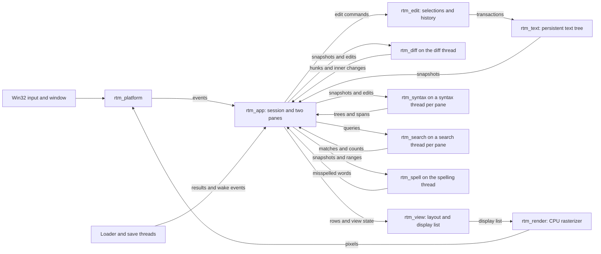
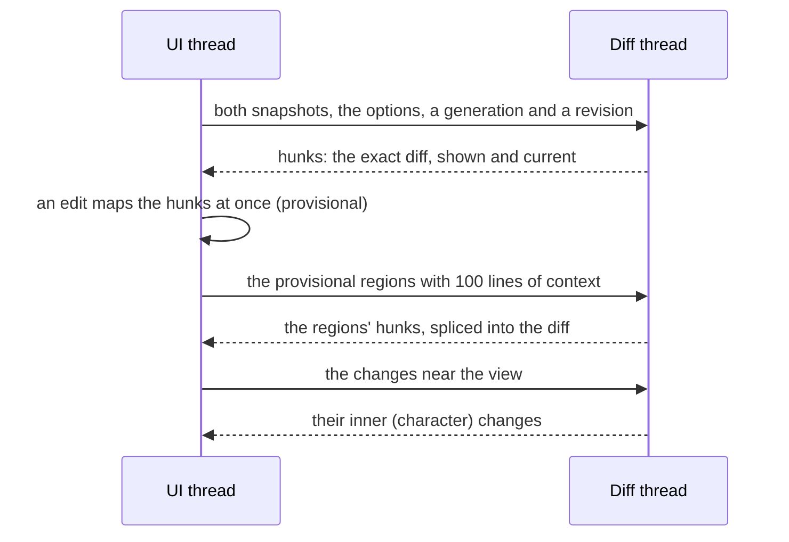

# Developer Guide

RoyiTextMerger is a Windows-first Rust application built on the design and
code of [RoyiTextEditor](https://github.com/RoyiAvital/RoyiTextEditor). Each
pane keeps the editor's editing, search, syntax highlighting, spelling and
safe saving; the Merger adds the comparison, the aligned two-pane view and
merging.

## Architecture

The window thread owns the session: both panes with their documents and
selections, the popups, the comparison state and frame construction.
Background threads receive immutable snapshots, return results through
channels and wake the window; they do not mutate UI state directly.

| Crate          | Responsibility                                                                                                                                  |
| -------------- | ----------------------------------------------------------------------------------------------------------------------------------------------- |
| `rtm_text`     | Persistent piece tree, immutable snapshots, line queries, transactions, position mapping, UTF-8/UTF-16 conversion and the diff of two versions. |
| `rtm_edit`     | Byte-offset selections, caret motion, editing commands, clipboard data and undo history.                                                        |
| `rtm_diff`     | Line diff (histogram with Myers, within a time budget), verification, inner changes, the row alignment and the mapping of edits.                |
| `rtm_search`   | Literal, Glob and regular-expression search over snapshots, and replacements.                                                                   |
| `rtm_spell`    | Words of prose, the spelling front end, the built-in word list, the Hunspell engine and suggestions.                                            |
| `rtm_syntax`   | Language registry and detection, tree-sitter grammars and queries, parsing sessions, highlight spans, brackets, selections and symbols.         |
| `rtm_view`     | Integer-cell layout, the two-pane frame (headers, divider, overview ruler), hit-test geometry and display lists.                                |
| `rtm_render`   | CPU glyph rasterization, caches, clipping, hatched fillers and framebuffer drawing.                                                             |
| `rtm_platform` | Raw Win32 window, input events, DIB presentation, clipboard, file operations and the Windows spell checker.                                     |
| `rtm_app`      | Startup, command dispatch, the session and its panes, loading, saving, the diff, search, syntax and spelling threads, and merging.              |
| `rtm_assets`   | Bundled default font and build-time font acquisition.                                                                                           |
| `xtask`        | Startup and performance benchmarks, import checks and release packaging.                                                                        |

## Comparison

The diff thread compares the two snapshots; the UI thread never waits for it,
except the first frame, which waits at most 10 ms so small files open
aligned.

- **Generation** counts what makes a diff another one: a file opened or
  reloaded, a swap, an option. A diff of an older generation stays drawn
  until its replacement arrives, but nothing acts on it.
- **Revision** counts every change of the hunks. A reply of an older
  revision is dropped.
- **Copies** act only on a fresh diff of the current texts; a copy pressed
  before it waits for it.
- `rtm_text` compares two versions of one text by skipping their shared
  subtrees, so undo and redo map the diff in microseconds.

The design, the review history and the decisions are in
[Plan/Architecture001.md](https://github.com/RoyiAvital/RoyiTextMerger/blob/main/Plan/Architecture001.md).

## Build and Validation

The repository targets Windows x64 with the GNU Rust toolchain and
`x86-64-v3` CPU features. `windres` is required to embed the application
manifest, icon and version information. Missing font assets are fetched from
pinned releases and SHA-256 verified by the `rtm_assets` build script.

Run focused tests for the crate being changed. Do not run the whole workspace
suite or performance suite unless requested; see
[AGENTS.md](https://github.com/RoyiAvital/RoyiTextMerger/blob/main/AGENTS.md).

| Task                             | Command                                            |
| -------------------------------- | -------------------------------------------------- |
| Run the application              | `cargo run --release -p rtm_app -- <left> <right>` |
| Test a crate                     | `cargo test -p <crate>`                            |
| Check formatting                 | `cargo fmt --all --check`                          |
| Run the documentation build      | `./tools/Build-Docs.ps1`                           |
| Measure startup                  | `cargo xtask bench-startup --pair`                 |
| Run the short performance report | `cargo xtask bench-perf --short`                   |
| Run selected performance tests   | `cargo xtask bench-perf --only L01,M01`            |
| Package a release ZIP            | `cargo xtask package`                              |

The workflow and the release process are documented in
[DEVELOPMENT.md](https://github.com/RoyiAvital/RoyiTextMerger/blob/main/DEVELOPMENT.md).
